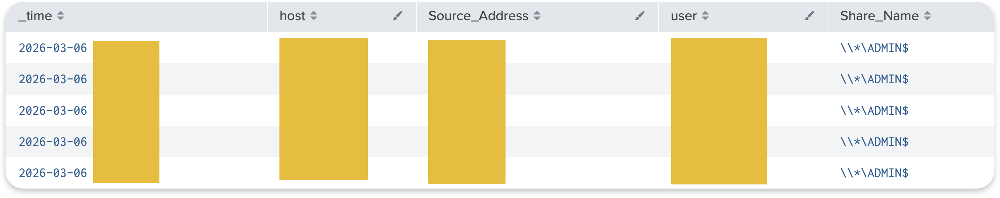

 SMB is the most common protocol used for lateral movement, and it's also the noisiest. Every time someone maps a network drive, opens a shared document, or prints to a network printer, SMB is involved. Group Policy updates and backup agents generate constant SMB traffic. There's a lot of legitimate SMB activity on any network, which is exactly why attackers like using it.
 ### Admin Shares
 Windows systems maintain default Administrative Shares ``(C$, ADMIN$, IPC$)`` created by the __Server service__ at boot. These shares leverage the __SMB protocol__ (Port 445) to allow remote management:

* ``C$:``Maps to the root of the system drive; additional drives follow the same pattern (``D$``, E$, etc.).
* ``ADMIN$:``Points to ``%SystemRoot%`` (typically ``C:\Windows``).
* ``IPC$:``A logical share for Inter-Process Communication via named pipes, essential for remote RPC calls.
Accessing these shares usually triggers two events: Event 5140 (A network share object was accessed) and Event 4624 (An account was successfully logged on).
Regular users don't access these during normal work. They use named shares like Marketing, Shared, or IT. When we see admin share access, it's either an administrator doing maintenance or an attacker moving laterally.
### Investigating Suspicious Admin Share Access
#### Investigating Event 5140 File Share Access
```splunk
index=win EventCode=5140 Share_Name IN ("*\\ADMIN$\*", "*\\C$\*")
| table _time, host, Source_Address, user, Share_Name
| sort _time
```

### Understanding Baseline Activity

Compare sensitive share access with the user's usual source machine, targets, and schedule. Backup agents and legitimate remote administration can also access administrative shares.

```splunk
index=win EventCode=5140 user="{USER_ACCOUNT}"
| table _time, host, Source_Address, user, Share_Name
| sort _time
```

The destination event identifies the target host, remote source address, account used, and share. A burst across many hosts from a new workstation is a useful lead.

### Trace the Source

The course uses machine-account logons to suggest a hostname for an IP:

```splunk
index=win EventCode=4624 Source_Network_Address="{SOURCE_IP}" user="*$"
| stats count by user, Source_Network_Address
| sort - count
```

**Caveat:** This is a clue, not an authoritative IP-to-host mapping. Confirm against DHCP, DNS, EDR or asset records at the event time. Machine identities can be used from other hosts, and IP addresses can change.

#### Commands on the source

```splunk
index=win EventCode=1 host="{SOURCE_HOST}" CommandLine="*ADMIN$*"
| table _time, host, User, Image, CommandLine
| sort _time
```

Sysmon's `User` is the process security context, not proof of the human at the keyboard. Compare it with alternate credentials in command arguments and **Event 4648** on the same source:

```splunk
index=win EventCode=4648 host="{SOURCE_HOST}"
| table _time, host, Subject_Account_Name, Account_Name, Target_Server_Name, Process_Name
| sort _time
```

Field names depend on extraction; inspect raw event sections to separate the caller from the account whose credentials were used. Event 4648 is not guaranteed for every credential-reuse technique. An in-process SMB client may leave no `net.exe` process; use destination share logs and available authentication telemetry as well.

### Query and Collection Caveats

The earlier share filter follows the room. If it returns no results, inspect the raw `Share_Name`: some datasets record a share ending exactly in `ADMIN$` or `C$`, without the trailing slash required by that pattern. A broader starting point is:

```splunk
index=win EventCode=5140
| search Share_Name="*ADMIN$*" OR Share_Name="*C$*"
| table _time, host, Source_Address, user, Share_Name
| sort _time
```

Refine this after inspecting actual values. Event 5140 requires File Share auditing; detailed object access uses 5145 and its separate audit subcategory. Share access proves neither remote execution nor malicious intent on its own.

Source for the added sections: [TryHackMe — Detecting AD Lateral Movement, Task 4](https://tryhackme.com/room/detectingadlateralmovement). Existing text and screenshot retained; caveats are supplementary.
