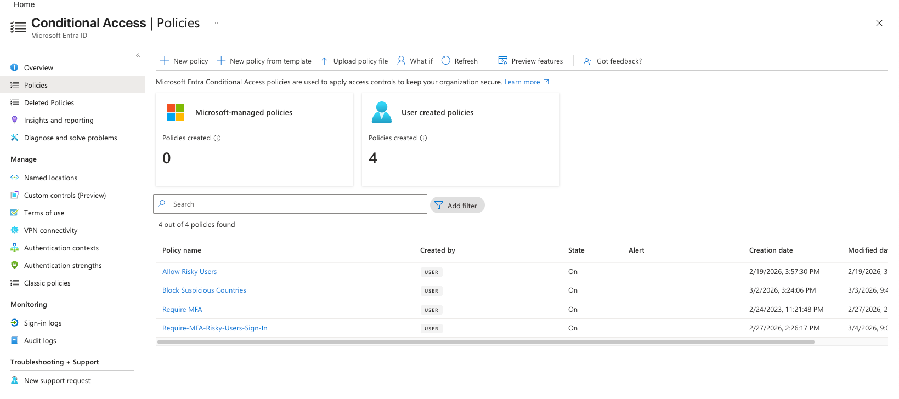
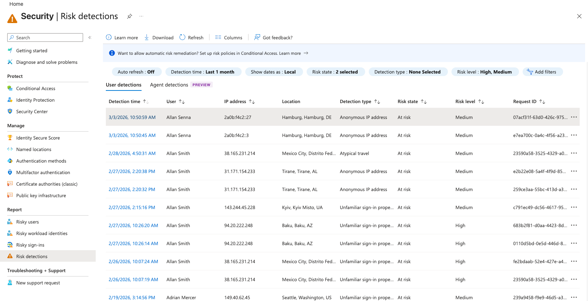

# Conditional Access and Identity Protection

**Conditional Access (CA)** evaluates conditions and applies access controls. **Identity Protection** supplies risk detections that can inform risk-based policies and investigations. Detecting risk does not automatically mean a policy blocked the request.

### Conditional Access Policies



*Course screenshot, Task 3: a tenant's policy list. A policy name alone does not establish coverage or enforcement; inspect scope, exclusions, conditions and state.*

| Policy objective | Example control |
| --- | --- |
| Protect authentication | Require appropriate MFA/authentication strength |
| Reduce legacy exposure | Block legacy authentication paths |
| Limit location-based access | Apply named-location or other network conditions |
| Trust managed endpoints | Require a compliant device |
| Respond to risk | Block or require remediation for applicable risk |

A service account excluded from an MFA policy can become a gap. Also inspect app scope, client type and policy state. Requiring MFA does not necessarily mean a fresh prompt on every request: existing authentication claims and session rules matter.

### Read Policy Results

| Per-policy result | Meaning for investigation |
| --- | --- |
| `success` | Applicable control requirements were satisfied |
| `failure` | Policy requirements were not satisfied or access was blocked |
| `notApplied` | The policy did not apply to that event |
| Report-only result | Evaluation without enforcement; exact result strings vary |

Look at `appliedConditionalAccessPolicies[]` as well as overall `conditionalAccessStatus`. A policy named “Require MFA” with `notApplied` did not prove MFA was enforced.

#### Failed policies — course-derived query

```splunk
index="task-3" sourcetype="azure:aad:signin" conditionalAccessStatus=failure
| spath output=policies path=appliedConditionalAccessPolicies{}
| mvexpand policies
| spath input=policies output=policy_result path=result
| spath input=policies output=policy_name path=displayName
| where policy_result="failure"
| stats values(policy_name) as FailedPolicies by _time, appDisplayName, userDisplayName, ipAddress, conditionalAccessStatus
| eval FailedPolicies=mvjoin(FailedPolicies,", ")
| table _time, appDisplayName, userDisplayName, ipAddress, conditionalAccessStatus, FailedPolicies
| sort 0 _time
```

`spath` extracts each policy object, `mvexpand` separates objects into rows, and the second extraction preserves each policy's name/result pairing. For production, retain the sign-in ID so distinct events at the same time are not accidentally merged.

### Identity Protection



*Course screenshot: the risk overview provides leads for investigation. Counts and classifications are examples from the lesson, not current findings in your tenant.*

| Risk concept | Meaning |
| --- | --- |
| Sign-in risk | Likelihood that a particular authentication is unauthorized |
| User risk | Likelihood that an identity is compromised |
| Risk detection | Individual signal contributing to assessment |
| Risk state | Current disposition/remediation context |

Signals include anonymous/risky IPs, travel anomalies, unfamiliar sign-in properties and leaked credentials. Some signals are evaluated later; absent alerts do not establish safe behavior. VPNs and service routing can also explain apparent location changes.

**Field clarification:** `riskLevelDuringSignIn` and `riskLevelAggregated` belong to the sign-in record. Do not equate the latter directly with the separate risky-user object's current risk level. Some risk details may be `hidden` because of licensing or visibility. See Microsoft's [signIn property reference](https://learn.microsoft.com/en-us/graph/api/resources/signin).

### Important Splunk Queries

#### High-risk sign-ins

```splunk
index="task-3" sourcetype="azure:aad:signin" riskLevelDuringSignIn=high
| table _time, userPrincipalName, appDisplayName, ipAddress, location.countryOrRegion, riskLevelDuringSignIn, riskLevelAggregated
| sort 0 _time
```

#### Risk detections

```splunk
index="task-3" sourcetype="azure:aad:identity_protection:riskdetection"
```

```splunk
index="task-3" sourcetype="azure:aad:identity_protection:riskdetection" riskEventType="anonymizedIPAddress"
| table _time, userPrincipalName, activity, ipAddress, location.countryOrRegion, riskLevel, riskEventType
| sort 0 _time
```

#### Risky user state

```splunk
index="task-3" sourcetype="azure:aad:identity_protection:risky_user"
| table _time, userPrincipalName, riskLevel, riskState, riskDetail
| sort 0 _time
```

The lesson prose also uses the shorter name `azure:aad:riskdetection`; the executable examples use the longer sourcetype above. Inspect actual sourcetypes if a search is empty.

### Practice Method

Identify the risky user, read the latest relevant detection, inspect the sign-in's source and risk type, and determine the exact policy that blocked access. Keep “risk detected,” “policy applied,” and “access succeeded” as separate conclusions.

Source: [TryHackMe — Entra ID Monitoring, Task 3](https://tryhackme.com/room/entraidmonitoring). Text rewritten; course figures retained and field caveats added.
