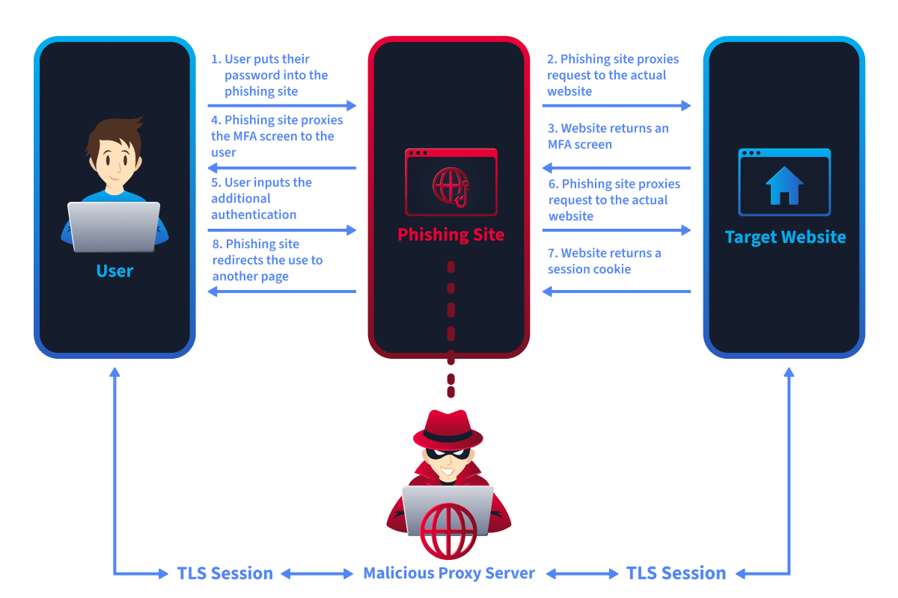

# MFA Bypass Techniques

MFA reduces the value of a stolen password, but some attacks target user approval, the second-factor channel, or an already authenticated session. Investigate how authentication was satisfied rather than treating every successful MFA result as proof of the legitimate user.

### Authentication Model

The room illustrates password validation followed by a registered second factor and session issuance. This is a useful example, not the only Entra flow: passwordless methods and existing session claims can also satisfy authentication requirements.

### MFA Fatigue / Prompt Bombing

The attacker knows the password and repeatedly triggers push prompts, hoping the victim approves one. Look for:

- Repeated MFA-related failures for one identity.
- Consistent or related suspicious source context.
- A later success and subsequent unusual activity.

```splunk
index="task-4" sourcetype="azure:aad:signin" (status.errorCode=50074 OR status.errorCode=50076 OR status.errorCode=500121)
| stats count as mfa_failures values(status.errorCode) as errorCodes values(status.failureReason) as failureReasons by userPrincipalName, ipAddress
| sort - mfa_failures
```

These codes identify relevant authentication conditions, not a direct count of notifications delivered to a phone. Inspect authentication-step details and timing before concluding fatigue. Number matching and prompt context reduce the opportunity for accidental approval.

### SIM Swapping

An attacker takes control of a phone number through the carrier and receives SMS-based verification codes. Unusual device, browser or location after a successful SMS-backed sign-in can be a lead, but identity logs alone do not prove a carrier transfer occurred. Corroborate with the user and appropriate provider evidence.

### Adversary-in-the-Middle (AiTM) Phishing



*Course diagram, Task 4: a reverse proxy relays the login flow while exposing session material to the attacker. A completed MFA step does not by itself protect a subsequently stolen reusable session.*

```text
Victim → phishing proxy → real authentication service
            ↓                      ↓
       captures session       victim completes MFA
            ↓
       attacker reuses session where accepted
```

Possible evidence includes a successful request without a fresh prompt, a change in source context, and continued access using an existing MFA claim. Modern session protections and policies can limit replay, so this is not guaranteed to work against every session or configuration.

### Impossible Travel

Two near-consecutive sign-ins from distant apparent locations can suggest identity/session misuse. The room's practice data uses `impossibleTravel` as the detection value; APIs and detection types can expose other travel-related names. Inspect the actual records.

#### Successful sign-in timeline

```splunk
index="task-4" sourcetype="azure:aad:signin" status.errorCode=0
| table _time, userPrincipalName, ipAddress, location.countryOrRegion, conditionalAccessStatus
| sort 0 _time
```

Filter to a particular `userPrincipalName` when reconstructing one account's travel sequence. Compare city/coordinates, device, session context and network routes, not only country codes.

#### Room travel detections

```splunk
index="task-4" sourcetype="azure:aad:identity_protection:riskdetection" riskEventType="impossibleTravel"
| table _time, userPrincipalName, activity, ipAddress, location.countryOrRegion, riskLevel, riskEventType
| sort 0 _time
```

### Common False Positives

| Cause | Why location changes |
| --- | --- |
| Corporate VPN | The exit IP can be in a different country |
| Split tunneling | Different requests use different routes |
| Cloud services/integrations | Service-side IPs differ from the user endpoint |
| IP geolocation error | An address is mapped inaccurately |

### Practice Method

Identify the targeted user, inspect the MFA failure reason, establish usual source context, and locate the suspicious success. Then follow new authentication methods, role changes and service activity. A later success can belong to the real user, so correlate before attributing it to the attacker.

Source: [TryHackMe — Entra ID Monitoring, Task 4](https://tryhackme.com/room/entraidmonitoring). Rewritten notes and original course diagram; caveats added for interpretation.
