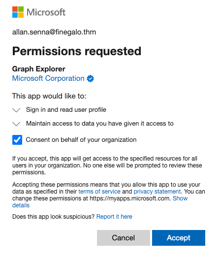
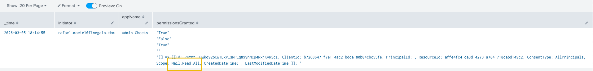

# OAuth Application Abuse

OAuth allows an application to request access to resources without receiving the user's password. Authentication commonly uses OpenID Connect alongside OAuth. An attacker-controlled application can misuse approved permissions, so account-password remediation alone may leave an app-based access path behind.

### Consent and Tokens

```text
Application requests permissions → user/admin reviews consent
                                           ↓
                              permission grant is recorded
                                           ↓
                           application obtains allowed tokens
                                           ↓
                              resource API access
```

Consent, an access token, a refresh token and an application credential are different objects. Investigate which exists and which identity/permission model the application uses. A grant is not an access token with an unlimited lifetime.



*Course screenshot, Task 6: inspect the requested actions, application identity and consent scope. Familiar branding or a plausible app name does not establish that the application is trusted.*

### Delegated vs Application Permissions

| Dimension | Delegated | Application / app-only |
| --- | --- | --- |
| Context | Acts for a signed-in user | Acts as the application |
| Effective access | Approved scopes and the user's permitted access | Granted app roles and applicable resource restrictions |
| Consent | User or administrator, subject to scope and tenant policy | Administrator consent |
| Main evidence | User consent grants, user/session context and API activity | App role assignments, app credentials and workload sign-ins |

Delegated access can still be highly damaging, particularly for a privileged user. App-only permissions can be broad, but do not assume every application has unrestricted tenant-wide access.

### Permission Accuracy Note

The room and its screenshot use `Mail.Read.All` / `Mail.ReadWrite.All`. For **Microsoft Graph**, the actual permission names are **`Mail.Read` / `Mail.ReadWrite`**; their application variants can cover all mailboxes, subject to restrictions. The delegated `Mail.Read` variant reads the user's mailbox. `offline_access` requests refresh-token capability and grants no additional data permissions. Verify names and permission type against the actual API and resource. [Microsoft Graph permissions reference](https://learn.microsoft.com/en-us/graph/permissions-reference).

### High-Impact Access to Review

| Permission or capability | Investigation question |
| --- | --- |
| Mail read/write | Delegated or app-only? Which mailboxes and what actions? |
| `Files.ReadWrite.All` | Which permission type and file access scope were granted? |
| `RoleManagement.ReadWrite.Directory` | Could this application alter privileged role assignments? |
| `Directory.ReadWrite.All` | What directory changes can it perform? |
| `offline_access` | Can delegated access be renewed without active user interaction? |

These are review priorities, not automatic proof of malicious consent. Check business purpose, publisher/ownership, app IDs, scope, approving actor, result and subsequent use.

### Detect Consent in Splunk

The room's example uses **`index=main`** for this topic, rather than `task-6`. Validate actual index coverage before concluding there are no grants.

```splunk
index=main sourcetype="azure:aad:audit" activityDisplayName="Consent to application"
| eval initiator=coalesce('initiatedBy.user.userPrincipalName','initiatedBy.app.displayName')
| eval appName='targetResources{}.displayName'
| eval permissionsGranted='targetResources{}.modifiedProperties{}.newValue'
| table _time, initiator, appName, permissionsGranted
| sort 0 _time
```

### Relevant Splunk Screenshot: Consent Details



*Original course screenshot, Task 6: the table surfaces an initiating user, app display name and nested grant details. The highlighted `Mail.Read.All` text belongs to the lesson's example data; use the permission accuracy note above when investigating real Microsoft Graph grants.*

**What to notice:** permissions can be buried inside `targetResources[].modifiedProperties[].newValue`. Expand the raw record and preserve target/property associations. The `ConsentType: AllPrincipals` label in a delegated grant is not itself proof of app-only permissions.

### Investigation and Remediation Concepts

1. Identify the application by stable app/service-principal IDs, not display name alone.
2. Determine whether access is delegated, app-only, or both.
3. Establish the approved scopes/app roles, actor, result and affected users/resources.
4. Search workload sign-ins and service/API activity for actual use.
5. Review permission grants, app role assignments, credentials and sessions as applicable.

A password or MFA change is not guaranteed to remove a permission grant. Equally, consent is not proof of perpetual working access: token expiry, revocation, identity state, credentials and policy affect continuation. Removing an unauthorized grant and handling relevant tokens/credentials are distinct remediation steps. No tenant changes were made while preparing these notes.

Source: [TryHackMe — Entra ID Monitoring, Task 6](https://tryhackme.com/room/entraidmonitoring). Rewritten notes and original course screenshots; Microsoft permission correction identified explicitly.
