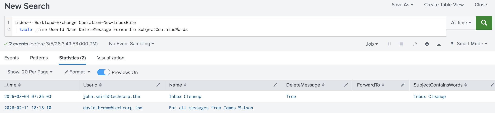
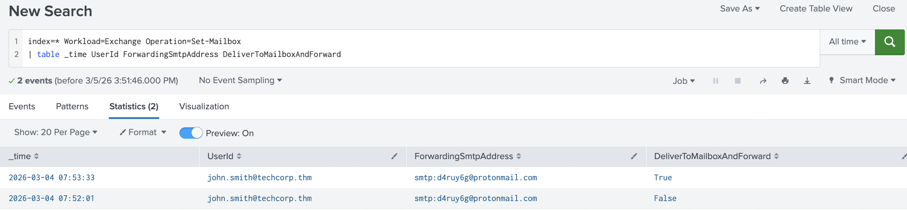

# Detecting Mailbox Rule Abuse

A compromised mailbox can be used to hide warning messages, export incoming mail or grant another identity access. Investigate **inbox rules, mailbox-level forwarding and delegates separately**.

### Inbox Rules

Rules can move, flag, delete or forward matching messages. Most are normal user automation. Suspicion comes from the conditions/actions, destination and surrounding identity activity.

| Field | Meaning |
| --- | --- |
| `Name` | Rule label; a plausible name does not establish legitimacy |
| `SubjectContainsWords` | Subject-based trigger |
| `DeleteMessage` | Delete matching messages |
| `ForwardTo` | Forward matching mail to the configured recipient |

```splunk
index=task4_5 sourcetype="o365:management:activity" Workload=Exchange Operation=New-InboxRule
| table _time, UserId, Name, DeleteMessage, ForwardTo, SubjectContainsWords
| sort 0 _time
```



*Task 4 course screenshot: inspect `DeleteMessage` with the matching conditions. An attacker may hide replies to phishing; legitimate cleanup rules can also delete messages.*

`Set-InboxRule` can record changed parameters without reproducing the rule's entire existing configuration. A missing field does not prove a setting was removed. Reconstruct preceding changes or inspect authorized current-state evidence.

### Mailbox-Level Forwarding

Mailbox forwarding is broader than a conditional inbox rule. Investigate both the destination and whether a local copy is retained.

```splunk
index=task4_5 sourcetype="o365:management:activity" Workload=Exchange Operation=Set-Mailbox
| table _time, UserId, ForwardingSmtpAddress, DeliverToMailboxAndForward
| sort 0 _time
```



*Task 4 course screenshot: compare the forwarding destination with `DeliverToMailboxAndForward`. False can mean delivery only to the forwarding destination when forwarding is configured; True keeps mailbox delivery as well.*

External destinations, unexpected changes after a suspicious login and forwarding without local delivery are useful leads. Actual delivery also depends on policy and configuration. A `Set-Mailbox` record by itself does not establish that every incoming message was exfiltrated.

### Delegate Access

`Add-MailboxPermission` can give another account access. Inspect the target mailbox, grantee/trustee, actual rights, result and later usage.

**Technical clarification:** Full Access does not automatically grant Send As or Send on behalf permissions. Do not infer sending rights from one mailbox-access permission. [Microsoft recipient-permission documentation](https://learn.microsoft.com/en-us/exchange/recipients-in-exchange-online/manage-permissions-for-recipients).

Supplementary review search:

```splunk
index=task4_5 sourcetype="o365:management:activity" Workload=Exchange Operation=Add-MailboxPermission
| table _time, UserId, ObjectId, Trustee, Parameters, ResultStatus
| sort 0 _time
```

Field extraction varies. If columns are empty, inspect the nested raw parameters; do not assume absent summary fields mean absent grants.

### Investigation and Response Concepts

Preserve the suspicious rule/settings and audit evidence, establish the actor's access, and coordinate removal of unauthorized rules, forwarding and permissions. Account/session remediation and configuration cleanup address different persistence paths. Determine the active interval and potentially exposed messages, then verify the unwanted behavior stopped.

These are study response steps, not actions performed in a tenant. Password changes alone do not remove rules, delegates, consent grants or every existing session.

### Practice

Task 4 uses `index=task4_5`. Find the externally forwarding rule, its subject trigger, and the mailbox-level destination from the actual dataset. The notes include method and queries, not invented lab findings.

Source: [TryHackMe — Exchange Online Monitoring, Task 4](https://tryhackme.com/room/exchangeonlinemonitoring). Course queries are scoped to the task's index; caveats and delegate review query are supplementary.
