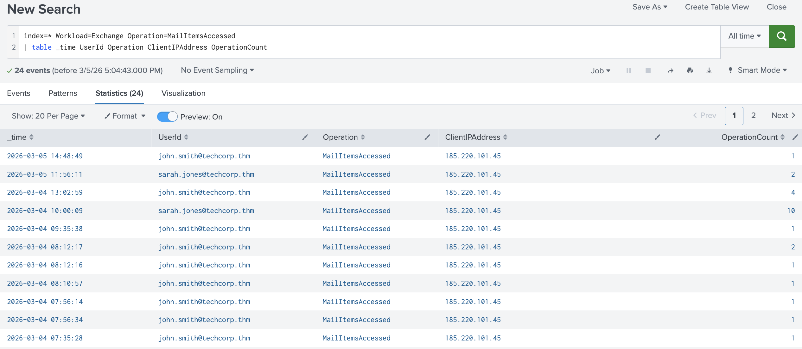
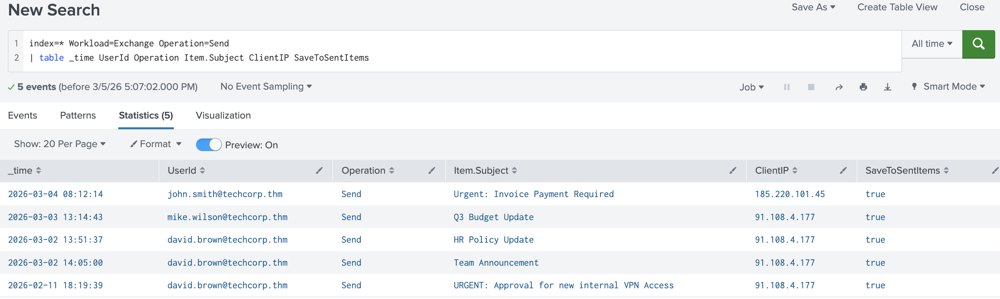
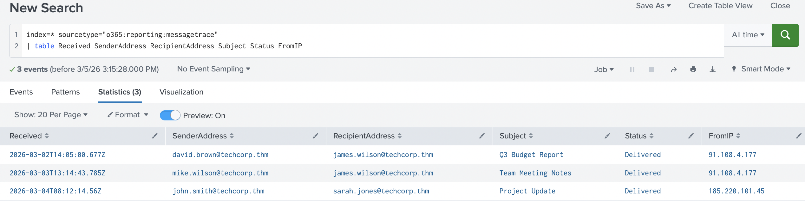

# Detecting Phishing from a Compromised Mailbox

An attacker may read genuine conversations, then send convincing phishing from the user's real mailbox. Internal identity can increase trust, while rules or omitted sent copies conceal the activity.

### Mailbox Reconnaissance

```splunk
index=task4_5 sourcetype="o365:management:activity" Workload=Exchange Operation=MailItemsAccessed
| table _time, UserId, ClientIPAddress, OperationCount
| sort 0 _time
```



*Task 5 course screenshot: review the account, source and access count. Investigate the detailed access type and item/session information before translating a count into a number of emails personally read.*

Compare with normal access sources, schedule, clients and expected mailbox synchronization. A large count or unusual IP is a lead; it needs context.

### Sending Activity

```splunk
index=task4_5 sourcetype="o365:management:activity" Workload=Exchange Operation=Send
| table _time, UserId, Item.Subject, Item.SizeInBytes, ClientIP, SaveToSentItems
| sort 0 _time
```



*Task 5 course screenshot: the message subject and source help identify candidate phishing. `SaveToSentItems=False` can explain why a sent copy is missing, but it is not proof of maliciousness.*

| Field / pattern | What to investigate |
| --- | --- |
| `UserId` | Sending identity and delegated context |
| `Item.Subject` | Campaign context; verify content safely where available |
| `Item.SizeInBytes` | Message size, not sufficient to identify contents |
| `ClientIP` | Source/service routing and identity correlation |
| `SaveToSentItems` | Whether a sent copy was requested |
| Rapid sending | Volume relative to normal behavior |

A subject like “urgent invoice” is not automatically malicious. Compare sender context, message content, links, attachments and business expectations.

### Message Trace: Scope the Recipients

```splunk
index=task4_5 sourcetype="o365:reporting:messagetrace" SenderAddress="{SUSPICIOUS_SENDER}" Subject="{MESSAGE_SUBJECT}"
| table Received, SenderAddress, RecipientAddress, Subject, Status, FromIP
```



*Task 5 course screenshot: one campaign can produce multiple recipient records. Count distinct recipients and distinguish delivery states; raw event count is not necessarily the number of affected people.*

Supplementary scoping summary:

```splunk
index=task4_5 sourcetype="o365:reporting:messagetrace" SenderAddress="{SUSPICIOUS_SENDER}" Subject="{MESSAGE_SUBJECT}"
| stats dc(RecipientAddress) as unique_recipients values(RecipientAddress) as recipients by Status
```

Correlate message IDs where possible. `Delivered` supports delivery, not proof of reading, link-clicking or credential submission. Review downstream security and sign-in evidence to assess actual compromise.

### Response Concepts

Coordinate containment of compromised access, preserve and scope the messages, and use an approved communication process to warn affected recipients. Investigate clicks, replies and further sign-ins. Review sent items and mailbox rules together: missing sent mail does not mean nothing was sent.

Task 5 shares `index=task4_5` with mailbox-rule practice. Reconstruct the suspicious subject, recipients and sending source from evidence, rather than assuming all activity outside the office IP is malicious.

Source: [TryHackMe — Exchange Online Monitoring, Task 5](https://tryhackme.com/room/exchangeonlinemonitoring). Rewritten notes and original screenshots; recipient summary is a supplementary template.
