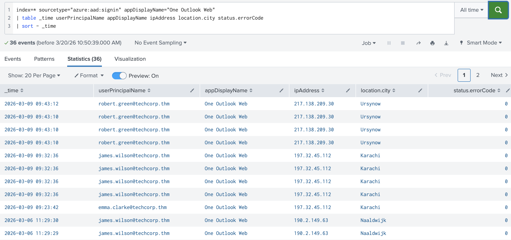
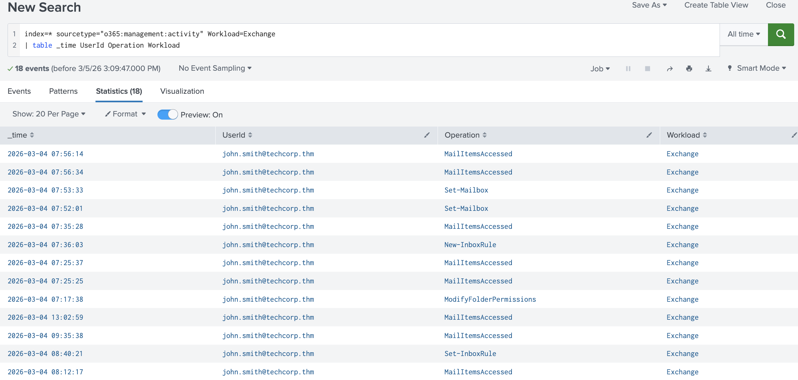
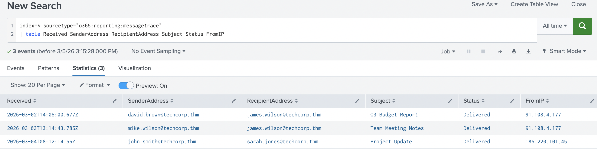

# Exchange Online Logging

Combine authentication, mailbox activity and message-delivery evidence. No one source explains the complete incident. Use **All time** to locate historical room data, then select a bounded investigation window.

### 1. Entra Sign-In Logs

Course-derived search:

```splunk
index=* sourcetype="azure:aad:signin" appDisplayName="One Outlook Web"
| table _time, userPrincipalName, appDisplayName, ipAddress, location.city, status.errorCode
| sort 0 _time
```



*Task 3 course screenshot: compare the account, application, source, location and result. The room uses `One Outlook Web`; other Exchange access paths can have different app/resource names.*

`status.errorCode=0` indicates a successful sign-in record. Check MFA, Conditional Access, resource and session context before deciding it represents unauthorized mailbox access. IP geolocation is a lead, not physical-location proof.

### 2. Unified Audit Logs

```splunk
index=* sourcetype="o365:management:activity" Workload=Exchange
| table _time, UserId, Operation, Workload
| sort 0 _time
```



*Task 3 course screenshot: `Workload` identifies the service and `Operation` identifies the action. Expand raw event parameters to understand exactly what was changed.*

| Operation | Investigation meaning |
| --- | --- |
| `MailItemsAccessed` | Mail item access, including relevant bind/sync behavior |
| `Send` | Message sending activity |
| `New-InboxRule` | New inbox rule |
| `Set-InboxRule` | Rule modification |
| `Set-Mailbox` | Mailbox configuration change, potentially forwarding |
| `Add-MailboxPermission` | Mailbox permissions granted |

**Coverage caveat:** not every user action is guaranteed to have an individual audit record. Availability, aggregation, configuration and licensing affect evidence. A generic mailbox-setting event is not automatically malicious forwarding.

### 3. Message Trace

```splunk
index=* sourcetype="o365:reporting:messagetrace"
| table Received, SenderAddress, RecipientAddress, Subject, Status, FromIP
```



*Task 3 course screenshot: sender, recipient, subject and status support campaign scoping. The `Received` source timestamp and Splunk `_time` should be checked for timezone/parsing differences.*

Message trace is especially useful for delivery and recipient scope. Some audit records also contain recipient details, so “audit logs never show recipients” is too broad. Trace records are the dedicated delivery evidence here.

### Correlation Principles

- Match message identifiers where available; subject alone can group unrelated messages.
- Preserve account, mailbox owner, actor, source and session identifiers.
- Use event result fields to distinguish an attempted change from a completed operation.
- A delivered message is not proof the recipient read it or clicked anything.
- An access record does not necessarily prove a human read every message represented by it.

The room illustrates `MailItemsAccessed` as mailbox reconnaissance. For exposure assessment, distinguish bind/sync and available item/session detail rather than treating every access record as an individual human read. [CISA's Microsoft cloud-log implementation playbook](https://www.cisa.gov/sites/default/files/2025-01/microsoft-expanded-cloud-logs-implementation-playbook-508c.pdf).

Source: [TryHackMe — Exchange Online Monitoring, Task 3](https://tryhackme.com/room/exchangeonlinemonitoring). Course searches are reformatted; `sort 0 _time` orders oldest to newest without the default sort result limit.
