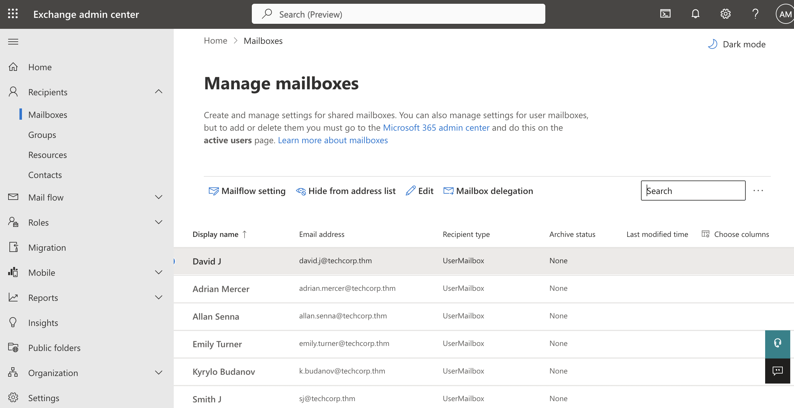
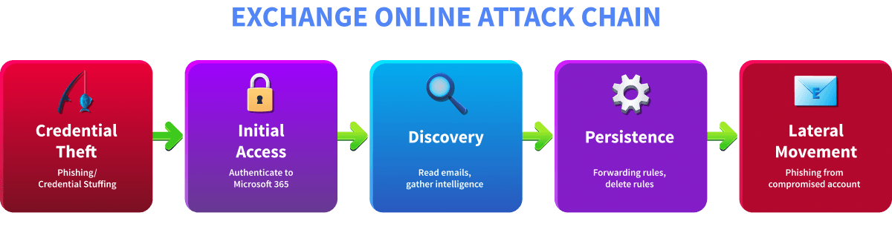

# Exchange Online Overview

**Exchange Online** is Microsoft's hosted email and calendaring service. **Outlook** is a client/interface used to access it; the two names are related but do not mean the same component. Microsoft operates the cloud service, while the organization still manages identities, permissions, policies and monitoring.



*Course screenshot, Task 2: the Exchange admin center lists mailboxes. This is service-management context, not evidence of a compromise.*

### Why a Mailbox Is Valuable

Email exposes business conversations, contacts, payment workflows, documents and potential secrets. A compromised sender is also a trusted identity that can be used against colleagues or partners. An ordinary mailbox compromise does not automatically grant Exchange administration or access to every mailbox.

### Typical Attack Chain



| Stage | What happens | Main evidence |
| --- | --- | --- |
| Credential theft | Phishing, reused passwords, stolen sessions or purchased access | Identity and phishing investigation evidence |
| Initial access | Attacker authenticates or reuses access | Entra sign-ins, client and policy context |
| Discovery | Mailbox contents and contacts are explored | Mailbox-access audit events |
| Persistence / concealment | Forwarding, inbox rules or mailbox permissions change | Exchange configuration audit events |
| Further targeting | Mail is sent from the compromised identity | Send events, message trace and recipient evidence |

The stages can overlap, occur in another order, or be absent. Forwarding can continue after password changes because it is a mailbox setting; that does not itself prove an attacker retains an interactive session.

### What the SOC Must Establish

1. Which identity and access path were compromised?
2. Which mailbox data was exposed, accessed or synchronized?
3. Were rules, forwarding or delegates altered?
4. What messages were sent, to whom, and with what delivery outcome?
5. Were further identities or resources affected?

A message from a real colleague may be more convincing, but internal origin does not guarantee bypass of all security controls. Content inspection, identity policies and other protections can still apply.

### Three Sources, Three Questions

```text
Entra sign-ins       → who accessed which app, from what context?
Exchange audit       → what mailbox action or setting changed?
Message trace        → what message went to which recipient, with what status?
```

The remaining notes explain these sources and their correlation. Screenshots are original course examples; no lab was run during this note rebuild.

Source: [TryHackMe — Exchange Online Monitoring, Task 2](https://tryhackme.com/room/exchangeonlinemonitoring). Text rewritten for study; Outlook/service and access-scope distinctions added.
