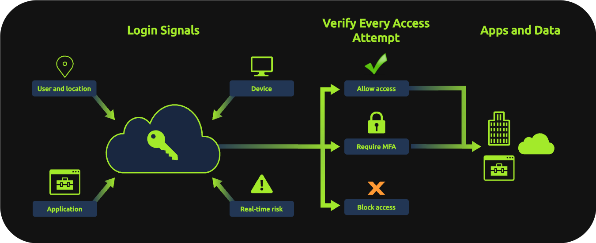

# Identities as the Target

Cloud identity endpoints are reachable from the internet. An attacker who obtains working credentials or a reusable session may reach corporate services without first compromising an internal workstation. The activity can resemble a real user, so endpoint alerts alone may miss it.

### Why Attackers Want Cloud Identities

| Advantage for an attacker | Consequence for the SOC |
| --- | --- |
| Internet-accessible authentication | Investigate attempts even without perimeter or endpoint alerts |
| SSO across services | Follow the identity into each application |
| Valid credentials and tokens | Look for misuse of legitimate access |
| High-value email and documents | Determine data exposure after sign-in |
| Administrative privileges | Check tenant changes and new access paths |

A compromised ordinary account may expose its permitted data. A privileged identity can have a much larger impact. Establish actual permissions rather than assuming every compromise gives full tenant control.

### Security Gaps

- MFA missing, unenforced, or excluded for a target account.
- Conditional Access policies that miss relevant users, apps, client types, or conditions.
- Unnecessary standing administrative privileges.
- Weak or reused passwords and incomplete password protections.
- Risk detections that do not trigger an effective response.
- Logging or monitoring gaps that allow suspicious behavior to persist.

These are configuration and coverage questions to verify in the actual tenant. Do not assume a specific default password or risk policy is in effect.

### How Access Decisions Fit Together



*Course diagram: identity and contextual signals feed an access decision. Read it as a model of evaluation; the actual controls depend on configured policies and their scope.*

### Evidence to Collect

| Evidence | Why it helps |
| --- | --- |
| Successes and failures | Reconstruct guessing, challenge and access stages |
| Failure reason / error code | Understand why a request was interrupted or denied |
| MFA details | Determine whether a challenge was required and how it was satisfied |
| IP and location | Compare with expected network routes and user activity |
| Device, browser and client | Identify changes in access context |
| Application/resource | Establish what the identity attempted to reach |
| Conditional Access results | Check which controls applied or failed to apply |
| Entra and M365 audit records | Find changes and data activity after authentication |

### Timeline Approach

```text
Sign-in attempts → successful access → identity changes → service activity
     Entra logs        Entra logs       Entra audit         M365 audit
```

Keep stable IDs, account names, IPs, resource names and timestamps. A request can involve multiple records; a failed step followed by a success is not automatically two unrelated users. Conversely, a success after failures is a lead, not proof that the same attacker caused every event.

Source: [TryHackMe — M365 Monitoring Basics, Task 3](https://tryhackme.com/room/m365monitoringbasics). Diagram reproduced from that lesson for study; explanatory text rewritten.
