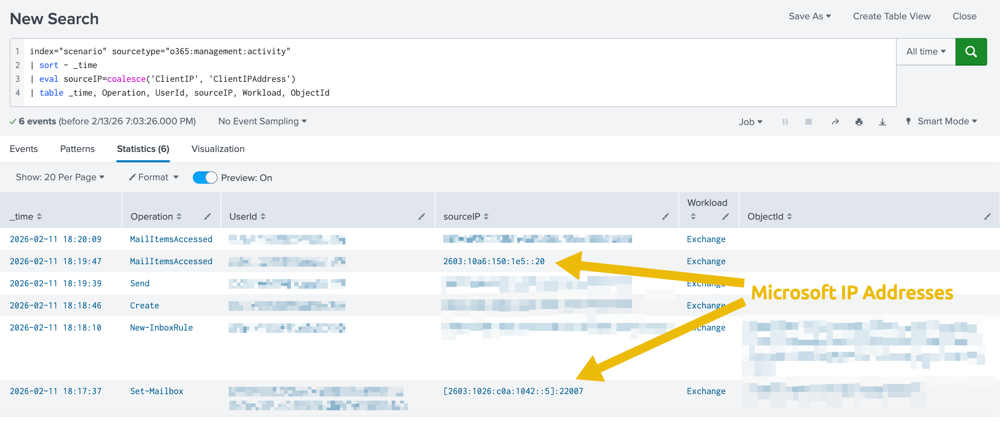

# M365 Audit Log Investigation

After identifying a suspicious identity, use workload audit activity to establish what happened in email, files and other services. Do not stop at the successful sign-in.

### Main Fields

| Field | Investigation meaning |
| --- | --- |
| `Operation` | Action, such as `New-InboxRule`, `Send`, or `FileAccessed` |
| `UserId` | Identity recorded as performing the action |
| `ClientIP` / `ClientIPAddress` | Source context; may represent a service rather than the user's endpoint |
| `Workload` | Service, such as Exchange or SharePoint |
| `ObjectId` | Affected resource where supplied |
| Operation-specific fields | Message, rule, file or configuration details |

These fields are useful starting points, not a guarantee that every operation contains every field.

### Important Splunk Queries

#### 1. Inspect workload audit records

```splunk
index=scenario sourcetype="o365:management:activity"
```

#### 2. Follow an account's actions

```splunk
index=scenario sourcetype="o365:management:activity" UserId="{USER_EMAIL}"
| eval sourceIP=coalesce('ClientIP','ClientIPAddress')
| table _time, Operation, UserId, sourceIP, Workload, ObjectId
| sort 0 _time
```

`coalesce` returns the first non-null value, allowing for the two source-field names. Inspect raw records where IPs include port notation or other formatting.

### Relevant Splunk Screenshot: Microsoft IP Addresses



*Course screenshot, Task 7: the result table combines `ClientIP` and `ClientIPAddress`. Highlighted Exchange entries show Microsoft IPv6 addresses, including one with a port. The screenshot's blurred values are part of the original image.*

**What to learn:** an IP associated with Microsoft infrastructure does not automatically identify the attacker's physical client, and it does not make the action safe. Correlate identity, operation, time and authentication context. Confirm address ownership and service routing before attributing a source.

### Suspicious Behavior to Investigate

| Behavior | Follow-up evidence |
| --- | --- |
| New inbox rule | Conditions and actions: delete, move, forward, or hide particular mail |
| Mass deletion or moves | Volume, affected folders, timing and normal user behavior |
| External messages | Recipients, message context and potential impersonation |
| Bulk file downloads | File paths, sensitivity, volume and user's usual access |
| External sharing | Recipient/domain, permission scope and sharing configuration |
| Unusual document access | Resource permissions and business justification |

### Reconstruct the Practice Scenario

Identify the workload and modification, then inspect the raw events for the sent message's subject, subsequent access to its response, and the response's folder path. Those details may not be present in the summary table, so expand the operation-specific records.

Keep chronological order and distinguish **an operation logged**, **a configuration changed**, and **data actually accessed**. Where relevant, preserve request/session identifiers and result fields. The notes do not invent answers or claim a live lab execution.

Source: [TryHackMe — M365 Monitoring Basics, Task 7](https://tryhackme.com/room/m365monitoringbasics). Course screenshot reproduced for personal study; query presentation changed to ascending timeline order.
