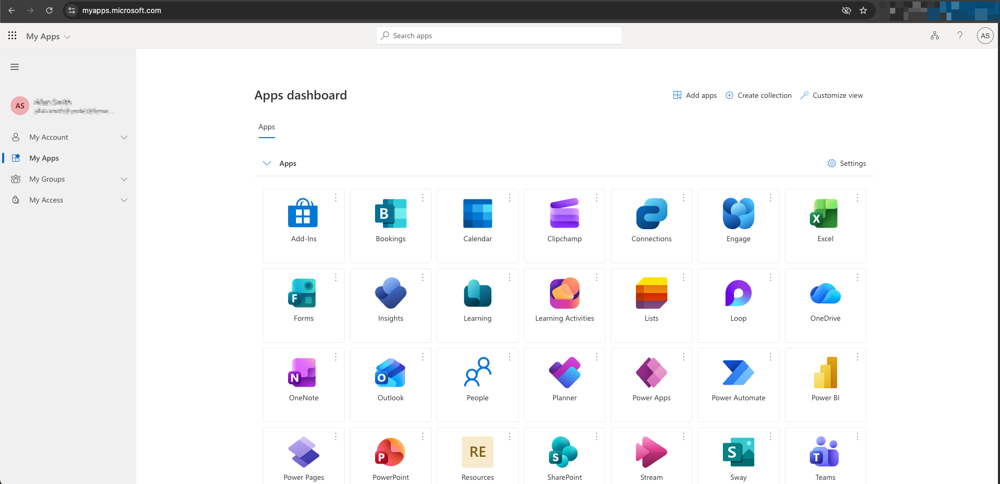

# M365 Services and Unified Audit Logs

Microsoft 365 combines productivity and collaboration services tied to Entra identities. **Entra sign-ins show access; service audit events show actions performed after access.**

*Course screenshot: the application catalogue illustrates the services an identity may use. Access still depends on licenses, assignments and resource permissions.*

### Main Services

| Service | Normal purpose | Investigation concerns |
| --- | --- | --- |
| Exchange Online / Outlook | Mail, calendar and mailbox management | Email access, sending, inbox rules, forwarding and permissions |
| SharePoint Online | Team sites and document repositories | File access, downloads, sharing and permission changes |
| OneDrive | User cloud file storage | Unusual downloads, sharing and file changes |
| Teams | Chat, meetings and collaboration | Suspicious communication and related resource access |
| Other connected apps | Reporting and business workflows | Application-specific administrative and data activity |

### Why Attackers Target These Services

Mailboxes contain sensitive conversations, business processes and potential secrets. Files can expose intellectual property and customer information. Attackers may search for further credentials, impersonate users, alter mailbox behavior, or grant an application access.

A malicious rule may continue forwarding or hiding mail after the password changes. That is persistent **behavior**, not proof that the attacker still has an interactive login. Investigate and remove the actual access or configuration mechanism.

### Unified Audit Log

The **Unified Audit Log (UAL)** brings audit activity from supported M365 workloads into a common investigation surface. Event coverage varies by operation, licensing, configuration and ingestion; do not assume every read or action appears identically.

| Workload | Useful activity types |
| --- | --- |
| Exchange | Mailbox access, sending/deleting mail, inbox rules, mailbox permissions |
| SharePoint / OneDrive | File access/download/modification, sharing and folder operations |
| Administration | Service configuration, permission and administrative changes |

Application permission changes may also need Entra audit evidence. Correlate sources instead of expecting a single log to describe the entire attack.

### Questions After a Suspected Compromise

1. Which applications and resources did the account actually reach?
2. What data did it access, send, download or share?
3. Were rules, forwarding settings, permissions or app grants changed?
4. What happened before and after the suspicious sign-in?
5. Does activity continue through another identity, session or application?

Continue with [M365 Audit Log Investigation](M365%20Audit%20Log%20Investigation.md) for fields, queries and the relevant Splunk screenshot.

Source: [TryHackMe — M365 Monitoring Basics, Task 6](https://tryhackme.com/room/m365monitoringbasics). Text rewritten; course application screenshot retained.
