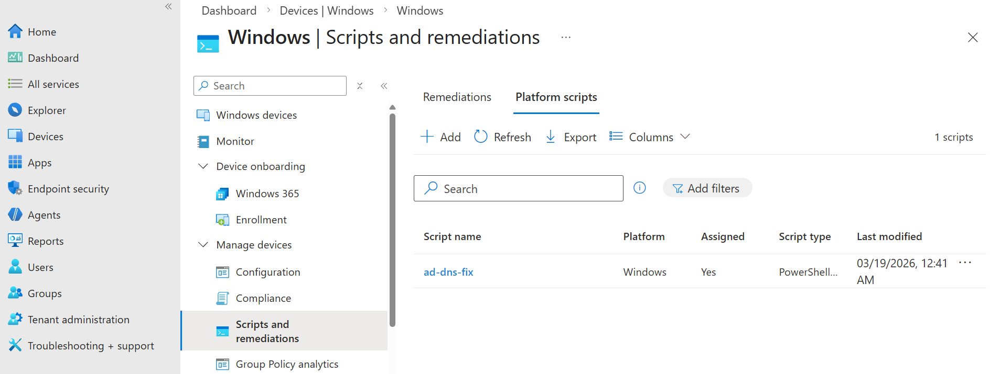
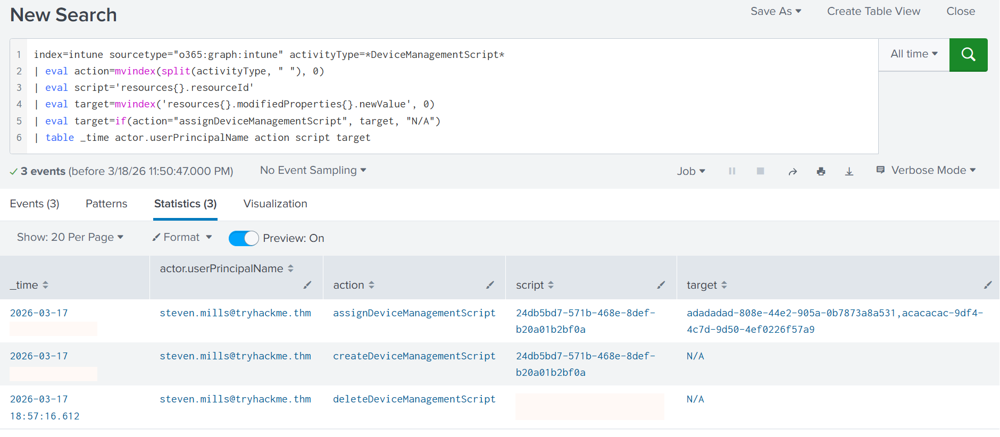
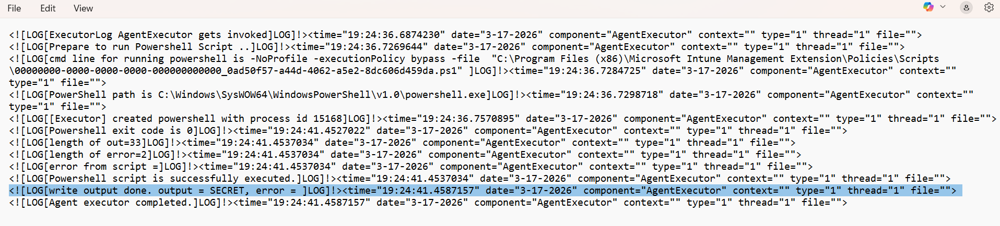
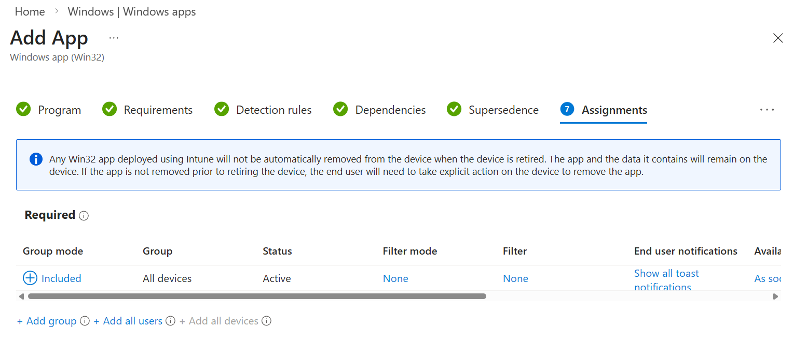

# Detecting Intune App and Script Deployment Abuse

An attacker with suitable Intune permissions can misuse legitimate deployment features to distribute commands or applications. Track **creation, assignment, endpoint execution and later cleanup** as separate stages.

### Platform Scripts

Scripts can run in supported user or system contexts depending on configuration. A deployment intended for maintenance can become a path for data theft or disruptive code when the management identity is compromised.



*Task 5 course screenshot: a plausible maintenance name is not proof of safe script content. Preserve the script ID, content/hash when available, settings and assignments.*

### Cloud Lifecycle Evidence

```text
Script created → targets assigned → device executes → script changed/deleted
     cloud             cloud           endpoint           cloud
```

Course query using the room's custom sourcetype:

```splunk
index=intune sourcetype="o365:graph:intune" activityType="*DeviceManagementScript*"
| eval action=mvindex(split(activityType," "),0)
| eval script='resources{}.resourceId'
| eval target=mvindex('resources{}.modifiedProperties{}.newValue',0)
| eval target=if(action="assignDeviceManagementScript",target,"N/A")
| table _time, actor.userPrincipalName, action, script, target
| sort 0 _time
```



*Task 5 course screenshot: deletion, creation and assignment are different actions. The pictured sequence does not independently establish successful execution on every target.*

The extraction assumes the example's array layout. Keep each resource and modified property together and identify values by their property names when adapting the query. Resolve target groups and virtual “all devices” assignments using authoritative inventory/assignment data, not a guessed hostname. The room's example uses `adadadad-808e-44e2-905a-0b7873a8a531` for All Devices; validate actual target type and schema.

### Endpoint Process Evidence

Windows platform-script execution can follow this course example:

```text
Microsoft.Management.Services.IntuneWindowsAgent.exe
  └─ AgentExecutor.exe
       └─ powershell.exe … Policies\Scripts\<identifier>.ps1
```

Collect Sysmon Event 1 or Security 4688 with command-line auditing. A management process launching PowerShell can be normal; inspect content, command arguments, user/system context, descendants and outcome. Do not generalize this Windows process tree to other platforms.

### Intune Management Extension Logs

The room highlights:

`C:\ProgramData\Microsoft\IntuneManagementExtension\Logs\AgentExecutor.log`



*Task 5 original log screenshot: execution metadata, output and errors can help distinguish assignment from an actual run. The demonstration's output belongs to that example, not a newly executed investigation.*

Script staging files may no longer remain after execution; local logs can retain useful traces. Review timing, start/finish, output and errors. The lesson's observed execution delay is not a guaranteed scheduling interval.

### Application Deployment

Intune can deploy supported app packages, including Windows `.intunewin` and relevant macOS formats. Execution privilege depends on platform and deployment configuration.



*Task 5 course screenshot: “required” assignment to broad target scope can create a large blast radius. Assignment is not proof of installation or execution on every target.*

```splunk
index=intune sourcetype="o365:graph:intune" activityType="*MobileApp*"
```

Inspect package provenance, installer command, assignment targets, actor, approvals and endpoint installation/execution. Do not assume “deployed through Intune” makes software trusted or that every app bypasses signing/security controls.

### Practice Method

Task 5 uses `index=intune` and endpoint logs from **PC-096**. Identify the deleted script ID, the replacement's assignment time, and actual execution output on that endpoint. Cloud assignment and endpoint execution require different evidence.

Source: [TryHackMe — Microsoft Intune Monitoring, Task 5](https://tryhackme.com/room/msintunemonitoring). Rewritten concepts, original screenshots and course-derived query with chronological sorting.
