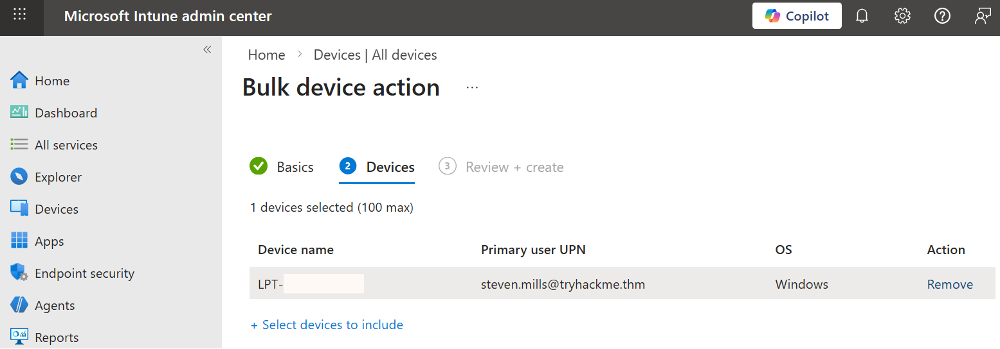
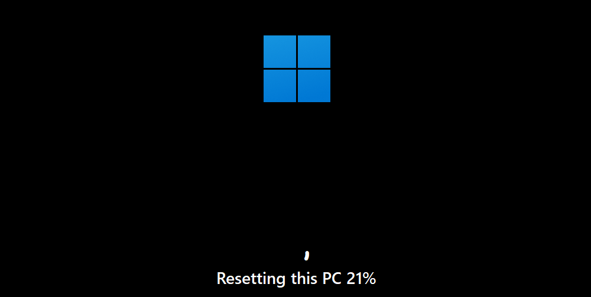
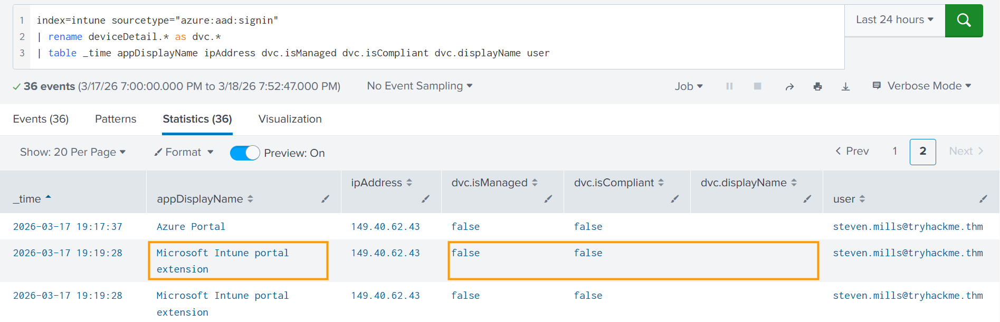
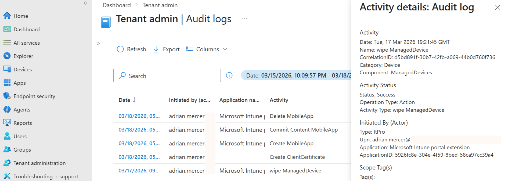
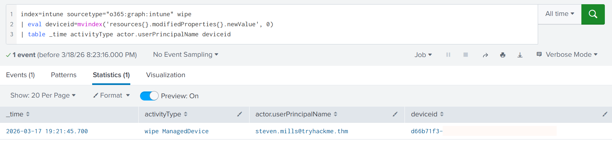

# Detecting Intune Remote Wipe Abuse

Intune remote actions are legitimate administrative tools. A compromised identity with the necessary permissions and target scope can misuse them to disrupt enrolled devices. Wipe behavior and available options differ by operating system and device state.

The course uses a reported large-scale destructive incident to motivate prevention. These notes focus on the observable technique rather than treating alleged access details or device counts as independently verified findings.

### Wipe Workflow



*Task 4 course screenshot: selecting devices for a bulk action demonstrates potential scope. The pictured selection is not proof that an action completed on all targets.*



*Task 4 course screenshot: endpoint reset state is impact evidence in that demonstration. A cloud audit success can instead represent acceptance of a request; confirm execution and affected scope separately.*

```text
Privileged access → wipe requested → cloud records action
                                           ↓
                            target receives/processes command
                                           ↓
                              device-specific reset/impact
```

### 1. Detect Risky Administrative Access

The room's portal application is `Microsoft Intune portal extension`. API-based operations may not produce the same browser-app pattern.

Course search:

```splunk
index=intune sourcetype="azure:aad:signin" appDisplayName="*Intune*" deviceDetail.displayName=""
| rename deviceDetail.* as dvc.*
| table _time, appDisplayName, ipAddress, dvc.isManaged, dvc.isCompliant, dvc.displayName, user
```



*Task 4 course screenshot: review the admin identity, source and device context. A blank display name is only a coarse hunt condition; null and empty values can behave differently in Splunk.*

Supplementary broader review:

```splunk
index=intune sourcetype="azure:aad:signin" appDisplayName="*Intune*"
| eval deviceContext=if(isnull('deviceDetail.deviceId') OR 'deviceDetail.deviceId'="","Missing device ID","Device ID present")
| table _time, userPrincipalName, appDisplayName, ipAddress, deviceContext, deviceDetail.isManaged, deviceDetail.isCompliant, status.errorCode
| sort 0 _time
```

Also inspect privileged API/workload access and grants involving relevant `DeviceManagementManagedDevices.*` or `DeviceManagementConfiguration.*` permissions. A consent record establishes a grant, not proof it was used for a wipe.

### 2. Intune Audit Events



*Task 4 course screenshot: `wipe ManagedDevice`, actor and correlation details support attribution of the management request. Preserve result, target and identifiers.*

Intune audit collection is distinct from ordinary M365 UAL ingestion. Microsoft supports routing through Azure Monitor destinations and retrieving audit events with Graph; a SIEM pipeline must be configured. [Microsoft audit-log documentation](https://learn.microsoft.com/intune/governance/monitor-audit-logs), [Azure Monitor integration](https://learn.microsoft.com/en-us/intune/governance/integrate-azure-monitor).

The room uses the **custom** sourcetype `o365:graph:intune`:

```splunk
index=intune sourcetype="o365:graph:intune" wipe
| eval deviceid=mvindex('resources{}.modifiedProperties{}.newValue',0)
| table _time, activityType, actor.userPrincipalName, deviceid
| sort 0 _time
```



*Task 4 course screenshot: the query extracts a device identifier for correlation. Taking array element zero is specific to the example schema; inspect property names and resource objects before treating it as the target in every event.*

### 3. Resolve the Target and Outcome

Correlate the relevant identifier with historical Intune inventory and Entra device-registration/audit records. Distinguish an Entra object ID, Entra device ID and Intune managed-device ID; they are not guaranteed interchangeable. Confirm hostname, platform, actor and source by time-appropriate records.

Task 4 uses `index=intune`. It asks for the wiped device ID, its hostname and the admin source. These must come from correlated evidence, not display-name assumptions.

### Detection Is Still Useful

Destructive commands can act faster than an analyst can respond, so prevent unauthorized privileged access and use appropriate approval controls. Still alert on wipes for rapid scoping, response and evidence preservation. Do not assume there is time to cancel an accepted command or dismiss post-action alerts as worthless.

Source: [TryHackMe — Microsoft Intune Monitoring, Task 4](https://tryhackme.com/room/msintunemonitoring). Course queries/figures retained with explicit schema, timing and outcome caveats.
