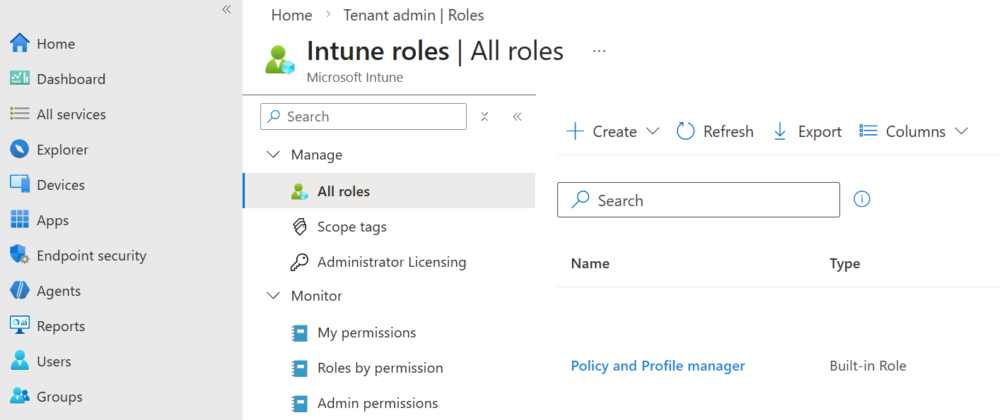
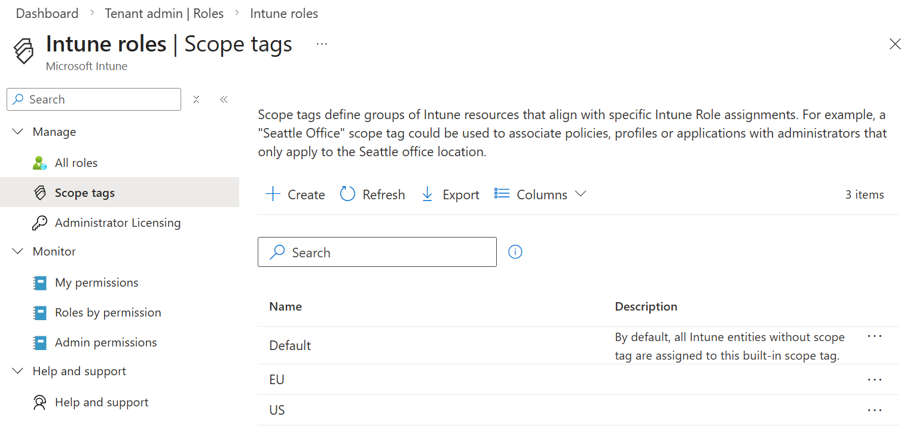
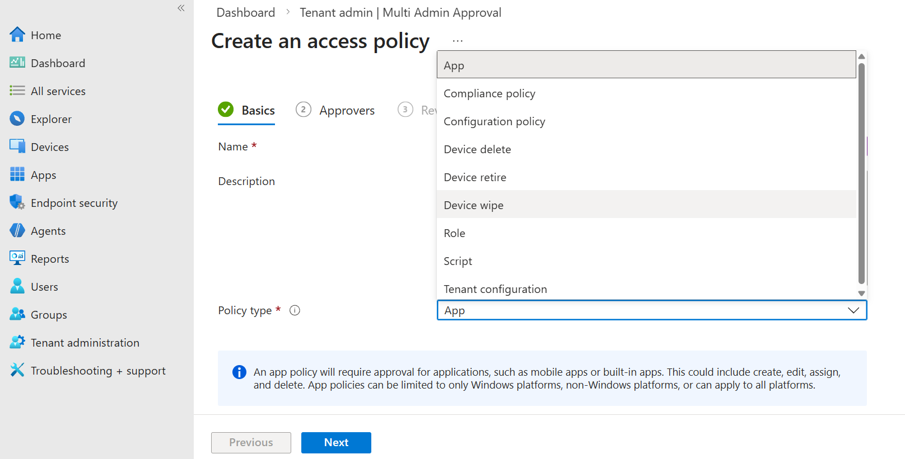

# Intune Security Hardening

Protect the management identities and limit what a compromised administrator could do. Monitoring, access controls, role scope and approvals address different failure points; no single control covers them all.

### Protect Privileged Identities

- Require suitable phishing-resistant authentication for privileged access, such as supported passkeys/security keys.
- Restrict access with Conditional Access and verify device, application and exception coverage.
- Review sign-in risk, unusual locations and unexpected administrative activity.
- Use Privileged Identity Management where appropriate to reduce standing access.
- Keep broad privileged assignments small and justified; maintain controlled emergency access.

The course's numeric Global Administrator target is a teaching recommendation, not a universal architectural rule. Count, capability, activation, monitoring and recovery design all matter.

### Separate Job Functions

*Task 6 course screenshot: review built-in permissions and define focused custom roles where they fit the required job. The role's name alone does not describe its effective access.*

| Team responsibility | Intended privilege boundary |
| --- | --- |
| Security response | Only required remote actions and device scope |
| Global endpoint team | Required script-management capability |
| Regional helpdesk | App management limited to its assigned scope |
| Regional configuration team | Necessary policy functions for its resources |

Do not give every operator full Intune administration merely because each needs one feature. Also review overlapping assignments and Entra-wide privileges that can undermine narrower Intune roles.

### Scope Groups and Tags

*Task 6 course screenshot: regional tags illustrate visibility boundaries. They must be combined with correct role permissions and assignments.*

**Scope groups** define the users/devices an assignment can manage; **scope tags** help limit visibility of Intune objects. Validate their combined effective access instead of treating a regional tag as a complete security boundary. [Microsoft RBAC and scope documentation](https://learn.microsoft.com/en-us/intune/intune-service/fundamentals/role-based-access-control).

### Multi Admin Approval

*Task 6 course screenshot: protect supported high-impact operations with an approval policy and a separate authorized approver. Review who can change the approval policy itself.*

Microsoft's Multi Admin Approval requires another administrator's approval before a protected change is applied. Supported policy/resource types and API coverage must be checked against current documentation and tenant configuration. [Microsoft Multi Admin Approval documentation](https://learn.microsoft.com/en-us/intune/fundamentals/role-based-access-control/multi-admin-approval).

Avoid an assumption that every dangerous action is covered simply because one policy exists. Validate the actor, resource, operation and alternate API paths within the approved administration workflow.

### Monitoring and Readiness

| Control/evidence | What to verify |
| --- | --- |
| Privileged sign-ins | Portal and relevant API/workload access are visible |
| Intune audit collection | Actor, action, target, result and timing arrive in the SIEM |
| Deployment evidence | Cloud creation/assignment can be linked to endpoint outcomes |
| Target inventory | Device/group identifiers resolve accurately at incident time |
| Approvals | Intended operations require independent authorization |
| Response readiness | Roles, owners and preservation procedures are documented |

Alert on both risky control-plane access and destructive actions. Pre-action safeguards reduce impact; post-action detections still support containment of ongoing compromise, scoping and recovery.

These are study recommendations, not a report that settings were changed or tested in a tenant.

Source: [TryHackMe — Microsoft Intune Monitoring, Task 6](https://tryhackme.com/room/msintunemonitoring). Concepts rewritten with current Microsoft references for scope and approval interpretation.
