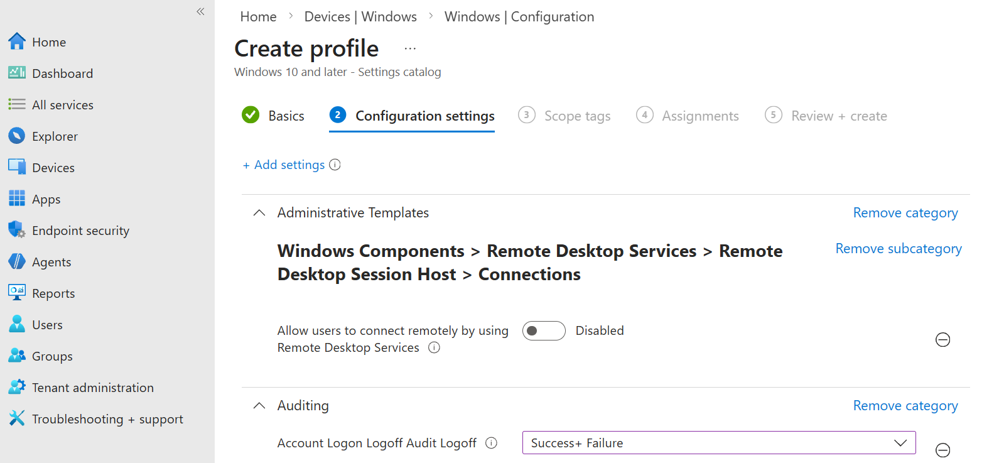
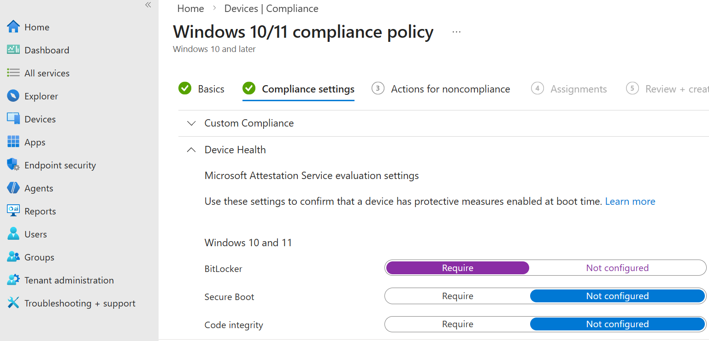
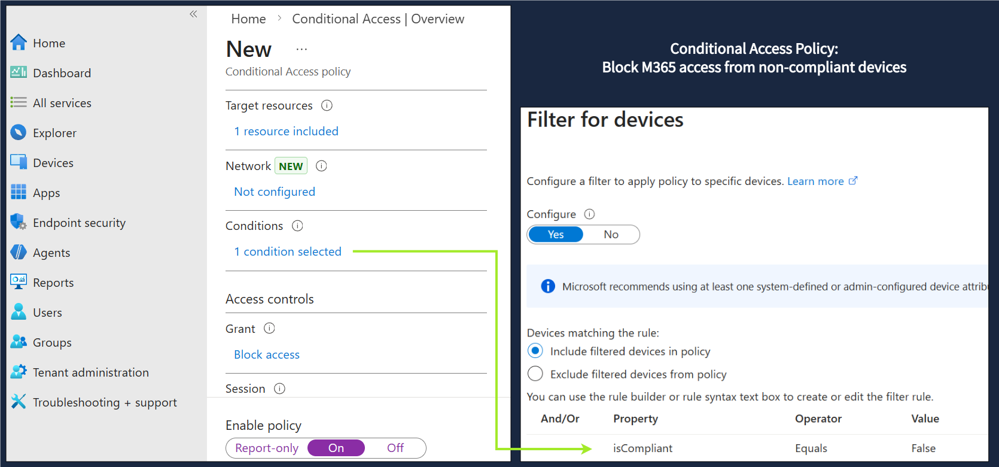
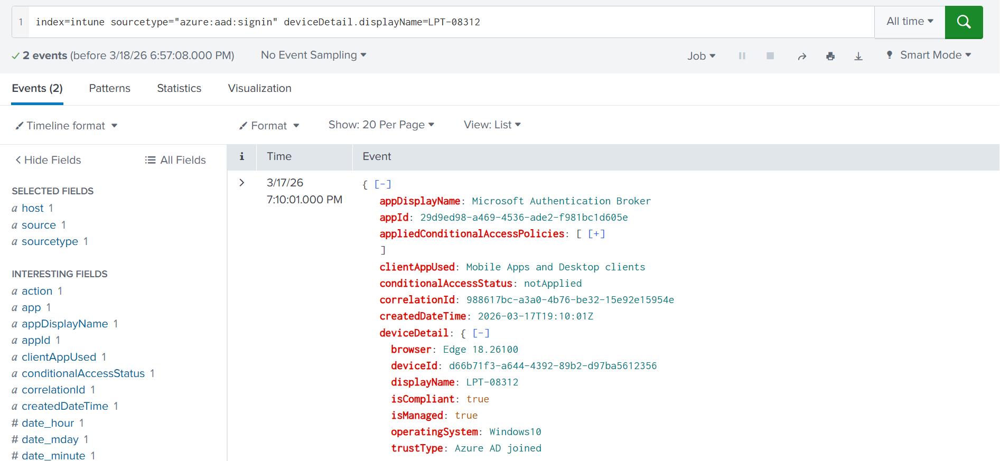

# Intune for Security Teams

The Intune console is an asset and management evidence source. A SOC analyst should understand its capabilities even when changes are performed by a separate endpoint team.

### Configuration vs Compliance vs Access

| Layer | Purpose |
| --- | --- |
| Configuration policy | Apply a setting on supported devices |
| Compliance policy | Assess device state against requirements |
| Conditional Access | Enforce access conditions for applicable identities/apps |

These layers work together but are not interchangeable. Marking a device non-compliant is not itself a universal block of every service; the relevant access policy must apply.



*Task 3 course screenshot: example settings restrict RDP and enable logon/logoff auditing. A configured policy is distinct from confirmed successful application on each endpoint.*



*Task 3 course screenshot: BitLocker is required while another setting is not configured. Assess the actual configured requirements rather than assuming “compliant” covers every security control.*

### Device-Based Access

An organization can use compliance requirements such as encryption and supported health/security settings, then require a compliant device through Conditional Access for appropriate resources.



*Task 3 course figure: device filtering is part of policy scope. Validate exclusions, unregistered-device handling and effective policy evaluation; a pictured configuration is not a universal template.*

### Device Context in Sign-In Logs

| `deviceDetail` property | Investigation use |
| --- | --- |
| `deviceId` | Correlate a recognized device identity |
| `displayName` | Human-readable context where present |
| `trustType` | Join/registration context |
| `isManaged` | Management information provided in this record |
| `isCompliant` | Compliance information provided in this record |



*Task 3 course screenshot: compare device fields across the related sign-ins. Empty device information means the record lacks that context; it is not conclusive proof of a malicious or unmanaged device.*

### Supplementary Review Query

```splunk
index=intune sourcetype="azure:aad:signin"
| rename deviceDetail.* as dvc.*
| table _time, userPrincipalName, appDisplayName, ipAddress, dvc.deviceId, dvc.displayName, dvc.trustType, dvc.isManaged, dvc.isCompliant, status.errorCode
| sort 0 _time
```

Do not use the display name alone as a stable join key. A managed/compliant device can be compromised or stolen, and token/session misuse can complicate attribution. Validate device state with inventory and endpoint telemetry at the relevant time.

### Collection and Availability

Plan for sign-in, Intune audit, device-status and endpoint evidence together. Licensing and supported functionality vary; verify the organization's actual entitlements rather than assuming every Entra user has Intune capabilities.

Source: [TryHackMe — Microsoft Intune Monitoring, Task 3](https://tryhackme.com/room/msintunemonitoring). Concepts and original figures; the review query and interpretation caveats are supplementary.
