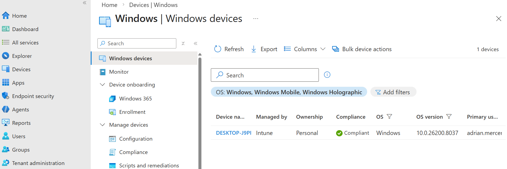

# What Is Microsoft Intune?

**Microsoft Intune** is a cloud endpoint-management platform. It supports device inventory, configuration, compliance assessment, application deployment and supported remote actions. It integrates with Entra ID for identity and access decisions.

### How Management Works

```text
Device enrollment → management relationship established
                              ↓
                 policies/apps/actions assigned
                              ↓
                 device checks in and processes work
                              ↓
                 status, reports and audit evidence
```

Enrollment can use operating-system capabilities and organization provisioning workflows. Signing into Windows with a work account does **not always automatically enroll the device**: licensing, enrollment scope, configuration and device eligibility matter.

The implementation differs by platform and workload. Native MDM components can handle some management, while extensions such as the Windows **Intune Management Extension (IME)** support additional functions. Avoid assuming every platform uses the same agent or process tree.

### Capabilities and SOC Uses

| Capability | Security-team use |
| --- | --- |
| Inventory | Identify device ownership, platform and management state |
| Configuration profiles | Apply supported hardening and audit settings |
| App management | Deploy, update or remove supported applications |
| Compliance | Assess whether configured requirements are met |
| Remote actions | Perform authorized supported actions such as restart or wipe |
| Entra integration | Use device compliance in access policy |

Support varies across Windows, macOS, mobile and Linux. A management capability on one platform is not automatically available on another. Network isolation is typically an endpoint-security capability or integration; do not assume Intune provides universal immediate isolation for every enrolled device.



*Task 3 course screenshot used here as an overview: management and compliance status provide asset context. They are not a guarantee the device is free of compromise.*

### Why Intune Is Security-Critical

The same centralized control that helps deploy defenses can become dangerous if a privileged identity is compromised. A malicious administrator may distribute code, alter policy or initiate destructive actions across assigned targets.

Treat Intune as a privileged control plane: protect administrators, limit permissions and targets, monitor both portal/API access, and collect cloud and endpoint evidence. The later notes cover wipe, scripts/apps and safeguards.

Source: [TryHackMe — Microsoft Intune Monitoring, Task 2](https://tryhackme.com/room/msintunemonitoring). Concepts rewritten; enrollment and platform-support caveats added. Screenshot originates from Task 3.
