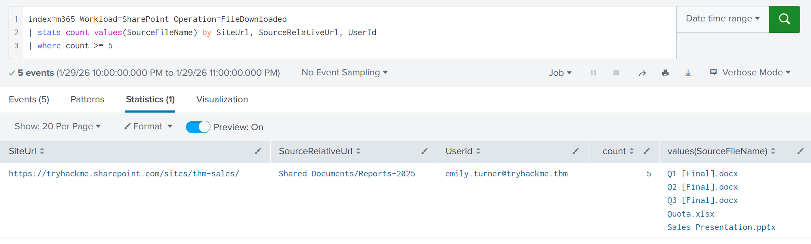
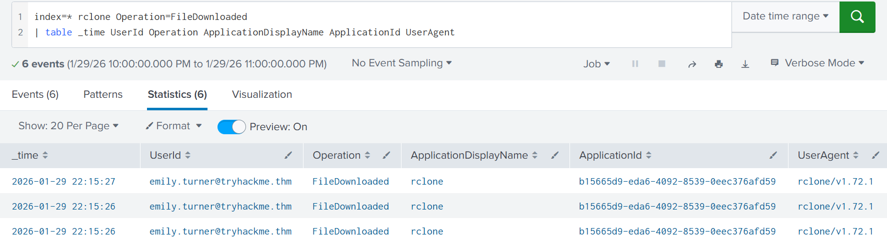

# Detecting SharePoint Data Exfiltration

After compromising an identity, an attacker may browse and read files, download selected documents or synchronize larger collections through an application. Exfiltration does not always mean one obvious archive download.

### Access Paths

| Path | Evidence to inspect | Limitation |
| --- | --- | --- |
| Browser reading | `FileAccessed` and resource context | Access is not proof of a human reading all contents |
| File/folder download | Download-related events and filenames | Event count may differ from unique-file count |
| Sharing link | Link creation/target and link use | Sharing alone does not prove recipient access |
| External app/sync | App identity, consent, user agent and file activity | Tool name alone does not establish maliciousness |

### Browser and Folder Downloads



*Task 4 course screenshot: one folder action results in five file-download events in the example. A burst can reflect one legitimate user action, so compare scope and sensitivity before calling it theft.*

Supplementary scoping query:

```splunk
index=practice sourcetype="o365:management:activity" Workload=SharePoint Operation=FileDownloaded
| bin _time span=15m
| stats count as download_events dc(ObjectId) as distinct_objects values(SourceFileName) as files by _time, UserId, SiteUrl
| sort 0 _time
```

A threshold must reflect the environment. Missing `ObjectId` affects distinct counts; inspect parsing. File downloads do not directly reveal how many bytes left the organization unless suitable size/transfer evidence is collected.

### Application-Based Export

OneDrive clients, Rclone and other tools can perform synchronization or API-based copying. A new or unusual app for a user can be a useful signal, especially when combined with broad file access.



*Task 4 reference screenshot: `ApplicationDisplayName`, application ID and `UserAgent` reveal app context. The room explicitly says this Rclone example is not in its practice dataset; do not expect the pictured records in `practice`.*

Supplementary review query:

```splunk
index=practice sourcetype="o365:management:activity" Workload=SharePoint Operation IN (FileAccessed,FileDownloaded)
| table _time, UserId, Operation, ApplicationDisplayName, ApplicationId, UserAgent, ClientIP, ObjectId
| sort 0 _time
```

Look for a new app, unusual file scope, uncommon source, consent/permission changes and sensitive resources. User-agent text can be spoofed; display names are not stable identifiers. Validate app IDs and permissions before assigning attribution.

### Exposure Assessment

Keep separate lists of resources **shared**, **accessed**, and **downloaded**. Determine whether the identity/app was authorized, whether links were public or restricted, and whether the access departed from the user's role. Low-volume reading of one sensitive document can matter more than a large authorized folder download.

Potential response includes containment of unauthorized identity/app access and revocation of unwanted sharing, while preserving evidence. Those are conceptual response steps; no changes were made to the user's tenant or lab.

Source: [TryHackMe — SharePoint Online Monitoring, Task 4](https://tryhackme.com/room/sharepointonlinemonitoring). Course concepts and original Splunk examples; queries here are supplementary study templates.
