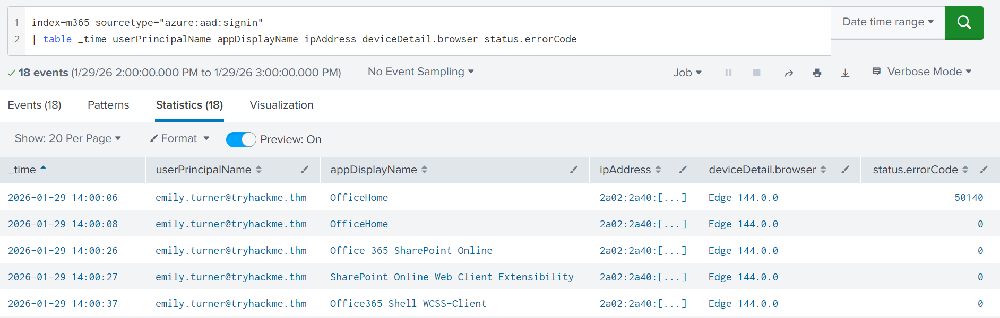
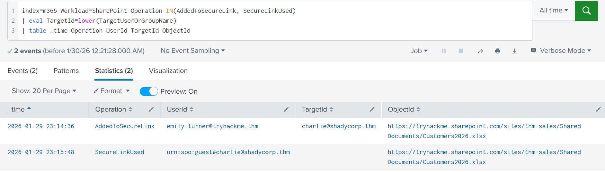

# SharePoint Logging and Sharing Events

Use **Entra sign-in logs** to establish authentication context and **M365 audit logs** to follow file actions and sharing. A user opening the M365 portal may generate several related sign-ins before reaching SharePoint.

### Authentication Chain

```text
M365 portal → SharePoint service → supporting Microsoft 365 client requests
```



*Task 3 course screenshot: not every application in the sequence is the target SharePoint resource. Inspect successful SharePoint-related events and their resource context, rather than taking the first portal event as proof of file access.*

IPv6 is not a false-positive category. Check address context and behavior regardless of IP version.

### File Audit Fields

| Field | Meaning |
| --- | --- |
| `CreationTime` / `_time` | Source and parsed event time |
| `OrganizationId` | Tenant identifier |
| `Workload`, `Operation` | Service and action |
| `UserId` | Recorded user/actor identity |
| `Site`, `SiteUrl` | Site identifier and URL |
| `SourceRelativeUrl` | Folder/path context |
| `SourceFileName`, `SourceFileExtension` | File identity/type |
| `ObjectId` | Target resource, often a full URL |
| `ApplicationDisplayName`, `ApplicationId` | App context where present |
| `UserAgent`, `ClientIP` | Client or service-side context |

The room's `FileAccessed` example shows `WebWord`, `MSWAC` and a Microsoft service IP. The source is not necessarily the user's endpoint. Verify ownership/routing and correlate sign-in context; do not equate `DeviceDisplayName` with a trustworthy hostname or address mapping.

### Main Operations

| Operation family | Investigation use |
| --- | --- |
| `FileUploaded` / creation-related records | Find new content and the uploading identity |
| `FileModified` | Detect changes to existing content |
| `FileDeleted`, `FileRecycled` | Understand deletion and recovery context |
| `FileAccessed`, `FileDownloaded` | Assess access and data movement |
| `AddedToSecureLink`, `AnonymousLinkCreated`, `SharingSet` | Sharing or access configuration |
| `SecureLinkUsed`, `AnonymousLinkUsed` | Use of a sharing link |

Actual operation names and coverage depend on activity and logging. These are the room's teaching examples, not a guarantee that every operation produces exactly one event.

### Sharing: Creation vs Use

Course-derived searches, scoped to the practice index:

```splunk
index=practice Workload=SharePoint Operation IN (AddedToSecureLink,AnonymousLinkCreated)
| table _time, UserId, Operation, TargetUserOrGroupName, ObjectId
| sort 0 _time
```

```splunk
index=practice Workload=SharePoint Operation IN (SecureLinkUsed,AnonymousLinkUsed)
| table _time, UserId, Operation, ObjectId, CorrelationId
| sort 0 _time
```



*Task 3 course screenshot: compare `AddedToSecureLink` with the later `SecureLinkUsed` for the same resource. A grant/notification is distinct from a recipient using the link.*

Secure links are not inherently external; inspect target identity/domain and sharing scope. Anonymous links need not identify an individual recipient. Include `SharingSet` and other applicable events as necessary rather than treating two operations as complete sharing coverage.

### Practice Method

Task 3 uses `index=practice`. Establish Emily Turner's SharePoint sign-in, find the PDF upload, then inspect sharing targets. Match user/resource/time and available IDs. Do not confuse a login record ID with a Windows event code: this is cloud audit data.

Source: [TryHackMe — SharePoint Online Monitoring, Task 3](https://tryhackme.com/room/sharepointonlinemonitoring). Text rewritten; query table columns and ascending order added for study.
