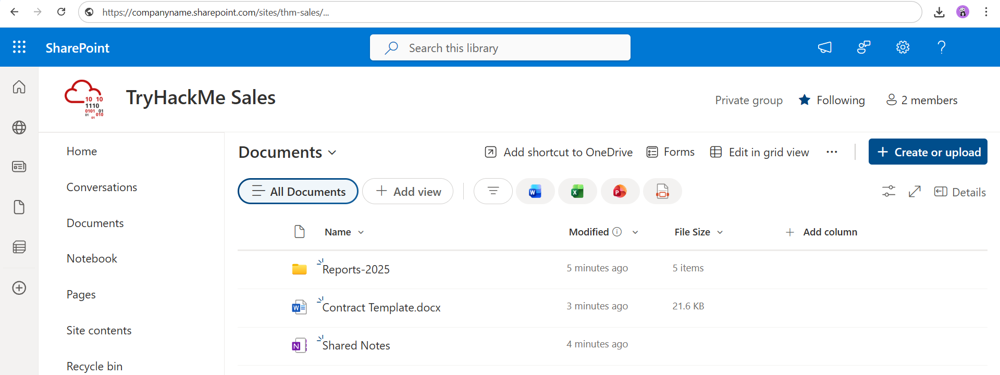
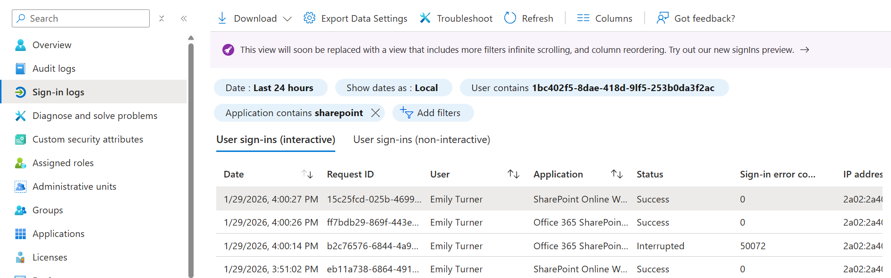

# SharePoint Online Overview

**SharePoint Online** provides shared sites, document libraries, lists and pages within Microsoft 365. It supports collaboration and organized access to corporate information. This room covers the cloud service, not SharePoint Server hosted by an organization.

### SharePoint, OneDrive and Sites

| Component | Main purpose |
| --- | --- |
| SharePoint Online | Team/organizational sites and shared information |
| OneDrive | A user's individual file workspace, with sharing capabilities |
| Site | Top-level collaboration/container context for libraries, pages and other resources |
| Document library | Files, folders, metadata and related access within a site |

OneDrive for work or school is not simply a consumer personal-storage product; it is part of the organization's Microsoft 365 environment. The distinction here is individual workspace versus shared site context.

*Task 2 course screenshot: a site document library contains folders and files. Record the site, path and filename when investigating a resource.*

### Identity and Permissions

Entra ID authenticates access to SharePoint Online. A compromised identity may reach the resources that identity is authorized to access, subject to policies and resource permissions. It does not automatically gain every site's data.

*Task 2 course screenshot: application and result fields help distinguish SharePoint authentication from related Microsoft 365 requests.*

**Site-type clarification:** group-connected team sites use Microsoft 365 groups, but communication sites are not automatically connected to such a group. Do not assume every site has a group mailbox. [Microsoft sharing and permissions overview](https://learn.microsoft.com/sharepoint/modern-experience-sharing-permissions).

### Why Monitor SharePoint?

| Site content | Potential impact of unauthorized access |
| --- | --- |
| IT documentation | Network details, source code or exposed secrets |
| Finance records | Confidential reports and commercial information |
| Sales material | Partner/customer contact lists and contracts |
| Executive/team collaboration | Sensitive decisions and plans |

Attackers can steal data, modify existing documents or upload phishing content and abuse the trust associated with sharing notifications. The later notes cover both **data exposure** and **SharePoint used as an attack channel**.

Source: [TryHackMe — SharePoint Online Monitoring, Task 2](https://tryhackme.com/room/sharepointonlinemonitoring). Rewritten concepts, original figures and site-type clarification.
