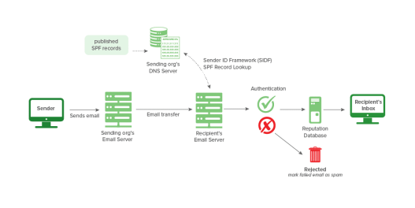
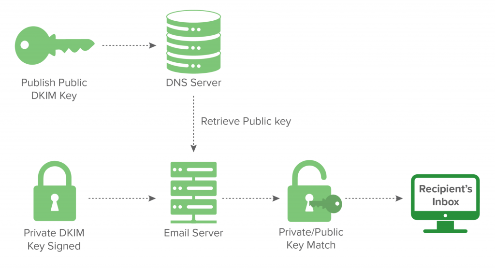

# Study Notes: Raw SMTP Mechanics & Custom Mail Server Freedom

## 1. The Core Concept: Infrastructure Capability
Anyone with a computer and an internet connection can set up a custom mail server using software like Postfix, Exim, or Microsoft Exchange. Building the actual network infrastructure to transmit messages requires no external authorization or permission from a governing body.

---

## 2. Total Input Control via Raw SMTP
When using a custom-built mail server, an attacker interacts directly with the transport and session layers of the network via the Simple Mail Transfer Protocol (SMTP), completely bypassing the application layer (the consumer email client).

* **Eliminating Client-Side Guardrails:** Standard consumer email clients (like Gmail or Outlook) require authentication and hardcode your true identity into the background headers. They do not allow users to modify the sender identity fields.
* **Direct Protocol Manipulation:** By connecting directly to an external network gateway on Port 25 using terminal utilities (like Netcat or Telnet) or custom scripts (such as Python), an attacker can type out raw SMTP commands line-by-line.
* **Absolute Identity Freedom:** Within this raw command environment, the sending server will accept any text string provided to it. The protocol itself allows an attacker to manually type whatever value they want into the structural fields:
    * The envelope routing address (`MAIL FROM`)
    * The visible inbox header address (`From:`)
* **The Interface Illusion:** This proves that the sender name and address displayed in an email app are merely plain text inputs generated by the sending infrastructure. On a server you control, you can change these variables to impersonate any entity (e.g., `admin@nasa.gov` or `ceo@apple.com`) without your own server blocking the action.

---

## 3. Visual Representation of Raw SMTP Data Injection

```text
[ Attacker Terminal Connection ]
               │
               │ Manual Line-by-Line Commands:
               │ 1. HELO attacker-server.com
               │ 2. MAIL FROM: <arbitrary-address@domain.com>
               │ 3. DATA
               │ 4. From: "Any Name You Want" <any-identity@target.com>
               ▼
   [ Custom Mail Server Software ]
               │
               │ Compiles text into standard data packet
               ▼
      [ Sent Into the Network ]
```

---

## 4. Key Takeaway
From a purely operational and generation standpoint, running a custom mail server means you do not have to worry about interface boundaries. You have total architectural control to construct, package, and send an email containing any sender identity or email address string you can type.


# Detailed Study Notes: Sender Policy Framework (SPF) Architecture

## 1. What is an SPF Record?
Sender Policy Framework (SPF) is an email authentication standard deployed as a public **DNS TXT record**. Its primary function is to list all authorized IP addresses and third-party mail servers allowed to send email messages on behalf of a specific domain name. This protocol serves as the first line of defense against domain spoofing and identity hijacking.

---

## 2. Core Operational Workflow
The diagram provided outlines the technical lifecycle an email undergoes during an SPF authentication challenge:

1. **Email Transmission:** A sender initiates an email. The message transitions from the **Sending Org's Email Server** over the internet via an "Email transfer" protocol session (SMTP).
2. **The SPF Record Lookup:** When the message hits the **Recipient's Email Server**, the receiving infrastructure pauses the transfer. It extracts the domain from the envelope routing header and reaches out to the **Sending Org's DNS Server** to fetch the published SPF records.
3. **Authentication Evaluation:** * **Pass:** If the connecting server's IP address matches an entry inside the published records, it clears authentication, is cross-referenced against local reputation databases, and is safely routed into the **Recipient's Inbox**.
    * **Fail:** If the IP address does not match any allowed entry, authentication fails, and the message is routed to a **Rejected** pool or marked as spam.

---

## 3. Deconstructing SPF Record Syntax
An SPF record combines specific tokens, tags, and mechanisms to dictate policies. Take the following common example:

`v=spf1 ip4:127.0.0.1 include:_spf.google.com -all`

* **`v=spf1`**: Specifies the protocol version. It must sit at the absolute beginning of the TXT string or the record becomes unparseable.
* **`ip4:127.0.0.1`**: Explicitly authorizes a standalone static IPv4 network address or a block range using CIDR notations (e.g., `ip4:192.0.2.0/24`).
* **`include:_spf.google.com`**: Acts as a nested shortcut or a pointer mechanism. Instead of manually listing thousands of IP addresses belonging to an outsourced service provider (like Google Workspace, Chargebee, or HubSpot) which change constantly, the `include:` mechanism tells the receiving gateway to dynamically look up that vendor's master SPF record and trust all IPs contained within it.
* **`-all` (The Hard Fail Qualifier)**: Directs the receiving gateway to completely drop, fail, or reject any incoming SMTP connection trying to use the domain name if it originates from an IP address not authorized in the record.

---

## 4. The SPF Verification Matrix
When processing the final qualifier tags, recipient servers follow an exact rule engine map to decide the final placement of an incoming message payload:

| Evaluation Result | Corresponding Qualifier | Impact / Action Taken by Gateway |
| :--- | :--- | :--- |
| **Pass, Neutral, None** | `+all` (or omission) / `?all` | The message is trusted or no strict rule is stated. It is accepted and processed normally toward the inbox. |
| **SoftFail, PermError** | `~all` | Indicates a soft failure. The IP is likely unauthorized, but the domain owner asks for leniency. The message is flagged as suspicious and shifted to the **Spam folder**. |
| **Fail, TempError** | `-all` | Indicates a hard failure. The IP address is fully unauthorized. The message is **immediately discarded or blocked** at the gateway barrier. |

---

## 5. Security Limitations Context
While SPF successfully cross-checks the physical connection IP address against the envelope routing address (`MAIL FROM`), it contains a core blind spot: **it completely ignores the user-facing "From:" header displayed in the email app client.** Because of this structural limitation, attackers utilizing custom-built mail servers can pass an SPF check by using a domain they control for routing while forging a high-trust name in the display client. Resolving this gap requires combining SPF with DMARC for strict identifier alignment check


# Study Notes: Email Authentication & DKIM Mechanics

This document compiles the technical questions and answers detailing the operational mechanics of **DKIM (DomainKeys Identified Mail)** and its relationship with **SPF** and **asymmetric cryptography** during cross-server email delivery.

---

## 1. Defining DKIM & Its Core Purpose
**Question:** What is the fundamental purpose of DKIM? Does it use asymmetric encryption?

**Answer:**
Yes, DKIM relies entirely on **asymmetric cryptography** (public/private key pairs) under the hood. Functionally, it acts as a **digital wax seal** or tamper-proof stamp for email.

Its core purposes are:
* **Proof of Authenticity:** Cryptographically proves that an email truly originated from the domain it claims to be from.
* **Proof of Integrity:** Ensures that the message body, links, and headers were not altered, modified, or tampered with while traveling over the open internet.

---

## 2. The Mechanics of the Keys
**Question:** Which keys are kept private? Does the private key get sent, or just the signature? If I send an email from Gmail to Yahoo, does Gmail fetch Yahoo's public keys, and does Yahoo keep its private keys hidden?

**Answer:**
The direction of key usage is determined strictly by the **sender**. The recipient server does not provide keys; it only fetches them.

### Key Deployment (Gmail to Yahoo Scenario):
* **The Private Key (Strictly Secret):** Google keeps its private keys locked securely inside its own outbound mail infrastructure. It is **never transmitted** over the internet. Instead, the server uses it to generate an encrypted mathematical output—the **DKIM Signature**—which is stamped into the hidden email headers.
* **The Public Key (Globally Available):** Google publishes its matching public key openly in its public DNS records (`_domainkey.gmail.com`). 
* **The Validation Flow:** When Gmail sends an email to Yahoo, **Yahoo's keys are completely irrelevant**. Yahoo's server catches the email, reads the signature, and fetches **Google's public key** from DNS to decode the signature. 

A signature generated by Google's private key can *only* be validated by Google's corresponding public key.



---

## 3. Vulnerability to Forgery and "Cracking"
**Question:** Is it possible for an attacker to create a public key that might crack the private signature? Why is DKIM alone not enough to stop spoofing?

**Answer:**
* **Mathematical Impossibility:** Asymmetric algorithms (like RSA or ED25519) rely on one-way mathematical problems (such as factoring massive prime numbers). An attacker cannot reverse-engineer a private key or forge a public key that tricks the math. Furthermore, receiving servers fetch public keys directly from the sender's real DNS records, completely ignoring any malicious keys an attacker tries to present.
* **The Real Vulnerability (Infrastructure Hack):** The math cannot be cracked, but the infrastructure can be compromised. If an attacker gains administrative access to your DNS hosting provider, they can publish *their own* public key inside your DNS settings, allowing them to send authenticated fakes.
* **The Structural Loophole (Why DKIM Alone Fails):** DKIM only ensures that the domain in the technical signature (`d=`) matches the private key that signed it. An attacker can buy a random domain (`attacker.com`), sign an email with their own valid key (yielding a **DKIM PASS**), but forge the human-readable display header to say `From: billing@paypal.com`. To close this gap, **DMARC** must sit on top to force alignment between the technical DKIM domain and the visible `From:` header.

---

## 4. Internal Server Routing vs. Cross-Server Delivery
**Question:** If the sender and recipient are on the same email server (e.g., Gmail to Gmail), do we still need DKIM? 

**Answer:**
Technically, **no**, it is redundant for internal mail. When mail stays inside Google's ecosystem, the message never traverses the untrusted public internet. Google already knows your identity via your account login, so no cryptographic verification is needed.

However, Google signs internal mail anyway for two operational reasons:
1.  **Unified Pipeline Architecture:** It is more computationally efficient to pass all outbound mail through a single standardized signing gateway rather than running scripts to evaluate if a message is internal or external.
2.  **Forwarding Protection:** If the internal recipient has a rule that automatically forwards incoming mail to an external network (e.g., Yahoo), the message will now cross into the public internet. Having the signature affixed from the start ensures it passes checks at its final destination.

---

## 5. Survival and Protection During Email Forwarding
**Question:** How does DKIM protect an email during forwarding? (e.g., You send from Google Workspace to a University server, which automatically forwards it to a personal Yahoo inbox).

**Answer:**
This scenario highlights why DKIM is mandatory alongside SPF. Email forwarding inherently breaks SPF, but DKIM survives the transit.

### Step-by-Step Forwarding Lifecycle:
1.  **The Context:** You own `yourdomain.com` on Google Workspace. Your public SPF record authorizes **only Google's IP addresses** (`include:_spf.google.com`).
2.  **The First Jump:** You send an email to `friend@university.edu`. It leaves a Google IP and carries a hidden `DKIM-Signature` stamped by Google's private key. The University server checks the Google IP against your SPF record. Result: **SPF PASS**.
3.  **The Forwarding Jump:** The University server automatically forwards the message to `friend@yahoo.com`. The machine physically connecting to Yahoo is now the **University Mail Server IP**. 
4.  **Yahoo's Evaluation:**
    * **SPF Checks:** Yahoo notes the connection is coming from the University IP. It checks your SPF record at `yourdomain.com`, which *only* permits Google IPs. Result: **SPF FAIL**.
    * **DKIM Checks:** Yahoo looks inside the payload and extracts the embedded `DKIM-Signature` header. It reads `d=yourdomain.com` and queries **your** DNS to fetch your public key. Because the University server forwarded the text data without altering the message body, the mathematical equation balances perfectly. Result: **DKIM PASS**.

### Conclusion:
Because **DKIM passed**, Yahoo knows the content is genuine and untampered, safely overriding the SPF failure caused by the forwarding middleman and delivering the email to the inbox.

# Study Notes: DMARC (Domain-based Message Authentication, Reporting, and Conformance)

## 1. What is DMARC?
**DMARC** is an email authentication management protocol that sits directly on top of **SPF** and **DKIM**. 

While SPF and DKIM act as foundational security guards verifying background technical fields, DMARC acts as the **security manager**. It establishes strict operational rules for the domain, ensures the visible identity matches the technical checks, and instructs recipient servers exactly how to handle unauthorized messages.

---

## 2. The Core Problem DMARC Solves: The Display Name Loophole
Before DMARC, an attacker could set up a malicious mail server, buy a random domain (e.g., `scamserver.net`), and configure valid SPF and DKIM settings for that domain. 

Using raw SMTP commands, they could still forge the human-readable header to read:
`From: Support <billing@securebank.com>`

Without DMARC, the receiving server would run checks against the background domain (`scamserver.net`), log an **SPF PASS** and **DKIM PASS**, and deliver the phishing email straight to the victim's inbox displaying the forged bank identity. DMARC was explicitly invented to close this visual spoofing loophole.

---

## 3. The Concept of Alignment
To prevent attackers from using valid background credentials to spoof a visible identity, DMARC introduces the rule of **Alignment**. DMARC mandates that the domain visible to the human reader in the **`From:`** header must match (align with) the domains authenticated by the background technical protocols.

* **SPF Alignment:** The domain found in the technical return-path (used by SPF to check server IPs) must match the domain visible to the user in the `From:` header.
* **DKIM Alignment:** The domain specified in the cryptographic signature's identity tag (`d=`) must match the domain visible to the user in the `From:` header.

### DMARC Pass Evaluation:
For an email to achieve a **DMARC PASS**, the message must pass at least one of the underlying protocols (SPF or DKIM), and that passing protocol **must align** with the visible identity. If an attacker spoof the visible domain, the technical alignment breaks, triggering a **DMARC FAIL**.

---

## 4. The Three DMARC Policies (`p=`)
When an email fails DMARC alignment, the domain owner does not leave the final outcome to chance. They publish a specific policy instruction inside their public DNS records, dictating the enforcement level:

1. **`p=none` (Monitoring Mode):**
   * **Action:** The email is delivered to the recipient's primary inbox as normal, even if it fails alignment.
   * **Purpose:** Used as a testing phase to gather data and verify that legitimate third-party services (like HR or marketing tools) are configured correctly before turning on enforcement.
2. **`p=quarantine` (Soft Enforcement):**
   * **Action:** The email is redirected away from the primary inbox and dropped directly into the recipient's **Spam/Junk folder**.
   * **Purpose:** Acts as a safety net to mitigate threat impact while still allowing access to mail if a legitimate internal system was accidentally misconfigured.
3. **`p=reject` (Hard Enforcement):**
   * **Action:** The receiving server blocks the email completely at the gateway layer. The connection is dropped, and the message is **permanently deleted** before it ever reaches the user.
   * **Purpose:** Provides the maximum possible level of security, completely neutralizing phishing and identity spoofing attempts by removing the human element from the equation.

---

## 5. Deconstructing a DMARC DNS Record
DMARC is deployed as a public plain text **TXT record** on a dedicated subdomain path: `_dmarc.yourdomain.com`.

### Example Record:
```text
Host/Name: _dmarc.securebank.com
Value: v=DMARC1; p=reject; pct=100; rua=mailto:reports@securebank.com
```

* **`v=DMARC1`**: Specifies the protocol version framework.
* **`p=reject`**: The enforcement policy rule applied to failing streams (can be `none`, `quarantine`, or `reject`).
* **`pct=100`**: Percentage of failing emails subject to the policy rule (100% means full application).
* **`rua=mailto:...`**: Reporting URI for **Aggregate reports**. This instructs global mail networks (Google, Yahoo, Microsoft) to automatically send daily XML diagnostic data back to the domain owner, listing every IP address on Earth that attempted to send mail using their domain identity.

---

 Comprehensive Guide to S/MIME and Email Security

## 1. Core Principles of S/MIME
* **OSI Layer:** Operates at the **Application Layer (Layer 7)**, providing true End-to-End (E2E) protection.
* **Cryptographic Foundation:** Relies on **Asymmetric Cryptography** (Public/Private key pairs) managed by a trusted third-party **Certificate Authority (CA)** using X.509 Digital Certificates.
* **Core Rule of Asymmetric Math:**
  * Data encrypted with a *Public Key* $\rightarrow$ Can **only** be decrypted by the matching *Private Key*.
  * Data encrypted with a *Private Key* $\rightarrow$ Can **only** be decrypted by the matching *Public Key*.

---

## 2. The Twin Pillars of S/MIME Functions
A user can choose to sign, encrypt, or execute both simultaneously.

### Pillar A: Digital Signatures (Identity & Integrity)
* **Purpose:** Proves exactly who sent the email (**Authentication/Non-repudiation**) and guarantees the text was not modified in transit (**Integrity**).
* **The Process:**
  1. Sender's client hashes the plaintext message body (e.g., via SHA-256).
  2. Client encrypts the hash using the sender's **Personal Private Key**. This forms the digital signature.
  3. The signature and the sender's Public Key Certificate are bundled into an `smime.p7s` file via a `multipart/signed` MIME infrastructure and sent.
  4. Recipient's client uses the sender's **Public Key** to decrypt the signature hash and matches it against a freshly calculated hash of the received text.

### Pillar B: End-to-End Encryption (Confidentiality)
* **Purpose:** Ensures absolute privacy. Intermediate mail servers (Google, Microsoft), network sniffers, and ISPs see nothing but unreadable ciphertext.
* **The Prerequisites:** The sender must already possess the recipient's Public Key Certificate (typically cached automatically after receiving a signed email from them).
* **The Process:**
  1. Sender selects "Encrypt" in their client.
  2. Client fetches the **Recipient's Public Key** from the local address book cache.
  3. Client scrambles the plaintext message into ciphertext.
  4. The email travels and sits *at rest* on intermediate servers as encrypted garbage data.
  5. Recipient's client uses their own **Personal Private Key** to decrypt and read the message.

---

## 3. Real-World Defense-in-Depth Email Architecture
In enterprise environments, security is deployed in nested, multi-layered stacks wrapping data multiple times.

### The Multi-Layer Pipeline:
1. **SPF (Sender Policy Framework):** Network-level verification. Validates whether the sending server's IP address is authorized to send mail for the domain.
2. **DKIM (DomainKeys Identified Mail):** Infrastructure-level cryptography. The outbound organization gateway server signs headers to prove domain authenticity.
3. **DMARC (Domain-based Message Authentication, Reporting, and Conformance):** Alignment and enforcement policy. Checks that visual headers match SPF/DKIM data and instructs recipient gateways to accept, quarantine, or reject failures.
4. **S/MIME:** Application-layer user security. Binds individual human identity and wraps the data payload itself, independent of mail servers.

### Architectural Distinctions:
* **DKIM vs. S/MIME:** DKIM keys live on the organizational **mail server** to validate the domain, while S/MIME keys live on the user's **endpoint device** to validate the individual persona.
* **TLS vs. S/MIME:** TLS encrypts the network pipe (**Data in Transit / Hop-by-Hop**), meaning the email sits in plain text once it lands on the provider's server. S/MIME encrypts the file object itself (**Data at Rest & Transit / End-to-End**), keeping it secure even if a mail server database is completely breached.